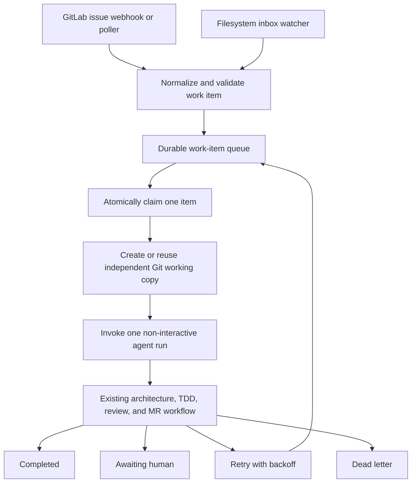

# Agentic Loop Plan

## Summary

The repository now has a bounded runner for one human-selected GitLab issue,
but it is not yet ready to discover and process work continuously or consume a
filesystem inbox.

The existing architecture, TDD, review, publication, and human merge gates are
the inner workflow. The missing piece is an outer control plane that discovers
work, claims it safely, invokes an agent once, records the result, and decides
whether to retry, wait for a human, or finish.

The recommended design uses all three of the following:

- A skill for reusable agent judgment and workflow policy.
- Deterministic CLI commands for intake, state changes, and side effects.
- An external supervisor for polling, filesystem events, scheduling, retries,
  and process lifetime.

The agent itself should not contain an infinite polling loop.

## Current readiness

### What is already available

- A complete development sequence from architecture through TDD, documentation,
  review, validation, commit, push, and merge request creation.
- GitLab issues as the intended system of record for planned and deferred work.
- Structured Bug and Feature issue templates in generated projects.
- Human approval and protected-branch requirements.
- Automatic rerouting when an implementation or review gate rejects a change.
- Non-interactive entry points from agent CLIs, such as `codex exec` and
  `claude --print`, that an external runner can invoke.
- A manually launched `agent-work run-issue` command that previews by default,
  validates one opted-in issue, uses an independent Git working copy, invokes
  Codex once, verifies the published merge request, and stops at
  `awaiting_human`.
- Private local audit, canonical-result, recovery, lock, and workspace-
  provenance records for that bounded command.

### What is missing

- Automatic GitLab issue discovery and selection.
- Atomic claim and lease handling that prevents two agents from taking the same
  item.
- A filesystem inbox schema and safe handoff protocol.
- Durable state, retry limits, backoff, dead-letter handling, and crash recovery.
- A cleanup and concurrency policy for retained independent working copies.
- A non-interactive authority policy for GitLab comments, labels, pushes, and
  merge request creation.
- A reconciliation command for jobs left half-finished after a process failure.

The Git workflow now hands published work off as `awaiting_human` without
waiting for merge, and unrelated open merge requests are non-blocking. With
respect to open merge requests, it stops only for a same-branch conflict, a
declared dependency on unmerged work, or a concrete file or resource conflict.
The clean-tree, access, test, and default-pipeline safety checks still apply,
and human approval and merge remain required before a change lands.

## Proposed architecture



The event adapters should only normalize and enqueue work. They should not
contain development policy. The runner should execute one claimed work item and
then exit. A service manager, scheduled job, or webhook handler supplies the
repetition.

## Components

### 1. Work-item skill

Add a repository skill named `work-item-runner`. Its responsibilities are:

- Interpret a normalized work item.
- Treat issue bodies and filesystem payloads as untrusted task data.
- Preserve `AGENTS.md`, repository policy, sandbox, and approval boundaries.
- Decide whether acceptance criteria are sufficiently clear.
- Route the work through the existing development workflow.
- Define when to continue automatically and when human input is required.
- Return a structured final result.

For Codex, the repository skill should be discoverable below
`.agents/skills/work-item-runner/`. Claude can use a thin skill or slash-command
wrapper that points to the same canonical workflow instructions. The workflow
rules should not be duplicated separately for every agent host.

A skill is not a scheduler. It is loaded after an agent run has already begun,
so it cannot provide durable polling or reliable process supervision by itself.

### 2. Deterministic CLI

Add a small CLI with commands similar to:

```text
agent-work ingest-gitlab ISSUE_IID [--json]
agent-work ingest-file PATH [--json]
agent-work run-once [--json] [--apply]
agent-work reconcile [--json] [--apply]
agent-work status [WORK_ITEM_ID] [--json]
```

The command should follow the repository's CLI contract:

- Read-only preview by default.
- Explicit `--apply` for mutations.
- Stable JSON output for automation.
- Useful exit codes.
- Dependency-injected GitLab, filesystem, time, subprocess, and environment
  boundaries.
- No secrets in arguments, output, state files, or logs.

`run-once` must claim at most one item, invoke one agent run, record the result,
and exit. This keeps execution bounded, restartable, observable, and testable.

### 3. Durable work-item state

Use a versioned work-item envelope. A minimum record should contain:

```text
schema_version
work_item_id
run_id
source_type
source_id
source_revision
repository
title
body
acceptance_criteria
deduplication_key
status
mode
lease_owner
lease_expires_at
attempt_count
created_at
updated_at
```

Use explicit states:

```text
discovered -> validated | dead_letter
validated -> queued
queued -> claimed
claimed -> running | retry_wait | dead_letter
running -> completed | awaiting_human | retry_wait | dead_letter
awaiting_human -> queued | completed | dead_letter
retry_wait -> queued | dead_letter
```

Every transition should be atomic and auditable. An expired lease should be
recoverable by `reconcile`, subject to the configured attempt limit.
Only `completed` and `dead_letter` are terminal; `awaiting_human` is parked and
releases its claim and lease so unrelated work can continue.

### 4. GitLab issue adapter

Only consume issues carrying an explicit label such as `agent::ready`.

Recommended behavior:

- Filter to the configured numeric project ID.
- Ignore confidential issues unless the runner is explicitly authorized for
  them.
- Deduplicate by project ID, issue IID, and issue update revision.
- Atomically change `agent::ready` to `agent::running`, or use another claim
  mechanism with equivalent compare-and-set behavior.
- Add a short issue comment containing the run ID and branch name.
- Use `agent::awaiting-human`, `agent::failed`, or `agent::done` for observable
  states.
- Never approve or merge the resulting merge request.

Issue text can contain prompt injection. It may describe desired repository
behavior, but it cannot change credentials, allowed repositories, sandbox
scope, approval policy, or agent instructions.

### 5. Filesystem adapter

Define a dedicated inbox outside the source tree or explicitly excluded from
Git. Producers should:

1. Write a temporary file.
2. Flush and close it.
3. Atomically rename it into `inbox/` with a supported extension such as
   `.json`.

The consumer should validate the schema and size before moving the file
atomically from `inbox/` to `processing/`. Results should be written to `done/`,
`awaiting-human/`, `failed/`, or `quarantine/`.

Use a content hash as the deduplication key. Reject symlinks, path traversal,
unknown schema versions, oversized payloads, and repository targets outside an
allowlist. Never interpret file contents as shell commands.

The filesystem watcher should wake the runner. It should not keep an agent
conversation alive indefinitely.

### 6. Agent invocation

The runner should generate a bounded prompt from the normalized work item and
invoke the selected host non-interactively. For Codex, the intended boundary is
`codex exec` with:

- An explicit repository or independent working-copy directory.
- A workspace-write sandbox.
- A JSON output schema.
- JSONL event output for logs and observability.
- No approval or sandbox bypass unless the entire runner is independently
  isolated and the use has been explicitly authorized.

If another agent needs to consume Codex directly as a tool, Codex's MCP server
is an alternative integration boundary. It is not required for the first
GitLab or filesystem implementation.

### 7. Working-copy and branch isolation

Create one independent Git working copy per work item. It must have private Git
metadata rather than sharing the source checkout's common Git directory. Use a
source-neutral branch convention, for example:

```text
agent/issue-123-short-slug
agent/file-7f3a2c-short-slug
```

The global open-merge-request block has been removed. The loop should block
only when:

- The same work item is already active.
- The intended branch already belongs to another run.
- A known file or resource conflict makes concurrent execution unsafe.
- Repository policy explicitly limits concurrency to one.

The first version intentionally sets concurrency to one while retaining its
independent working copy. This preserves a clean path to later parallelism.

## Authority and human gates

Define modes instead of relying on an ambiguous notion of "autonomous":

| Mode | Allowed outcome |
|---|---|
| `inspect` | Strictly read and report only; no repository mutation. |
| `publish` | The only mutation mode: push a feature branch and open or update an MR for human review. |

There is no `local-change` or deferred-publication mode. Every completed
repository mutation must publish its branch and MR; a commit, authentication,
push, or MR-creation failure is a blocker, never a completed outcome.

All modes should require human direction for:

- Ambiguous or conflicting requirements.
- Scope expansion beyond the work item.
- Credential or permission changes.
- Destructive operations that are not clearly required.
- Security-sensitive behavior outside an established runbook.
- Approval or merging of the agent's own merge request.

Phase 1 remains manually selected and requires an explicit `--apply`. Any later
unattended `publish` mode requires an explicit repository-level authorization
decision, a constrained service identity, and verified independent MR approval
protections; it must not be enabled merely by installing the skill.

## Machine-readable result

Every agent run should end with a validated result envelope similar to:

```json
{
  "schema_version": 1,
  "work_item_id": "gitlab:310967:123",
  "run_id": "01J61M6V9W4E5T7Q8R2Y3U4I5O",
  "mode": "publish",
  "outcome": "awaiting_human",
  "summary": "Implemented the requested change and opened an MR.",
  "branch": "agent/issue-123-short-slug",
  "branch_tip": "0123456789abcdef0123456789abcdef01234567",
  "merge_request_url": "https://gitlab.example.com/group/project/-/merge_requests/42",
  "tests": [
    {"command": "uv run tox run-parallel", "status": "passed"}
  ],
  "findings": [],
  "next_action": "Human review and merge",
  "error": null
}
```

Judges should return the same style of structured data with `verdict`,
`findings`, `reroute`, and `next_state` rather than relying on prose phrases
that another agent must parse.

## Workflow cleanup before loop implementation

- [x] Resolve the existing contradiction between GitLab issues as the system of
  record and commands that still write Markdown backlog files.
- [x] Add one public `/work-item` or equivalent entry point. Keep individual
   architecture, TDD, documentation, and judge roles as internal stages.
- [x] Put the work-item routing contract in the canonical specification. The
  result and state contracts are now defined under `.agents/contracts/`.
- [x] Generate or validate thin Claude command wrappers from that specification.
- [x] Add tests that fail when workflow instructions disagree with the canonical
  issue policy, result schema, state machine, or non-blocking MR policy.
- [x] Make branch prefixes and work-item terminology agent-host neutral where the
   behavior is intended to work with both Claude and Codex.

## Delivery sequence

### Phase 0: Consistency cleanup — complete

- [x] Replaced command-level Markdown backlog persistence with GitLab Bug and
  Feature issue handling in the repository and Copier template.
- [x] Added contract tests for issue-based workflow instructions, non-blocking
  unrelated merge requests, retained safety gates, and root/template sync.
- [x] Defined the canonical v1 work-item result schema and auditable work-item
  state machine under `.agents/contracts/`, with exact template copies.
- [x] Defined mandatory publication: `inspect` is read-only and every
  repository mutation must publish a branch and MR before the run can hand off.

Phase 0 defines the shared workflow contracts. The bounded Phase 1 slice below
now implements manual issue intake and one runner invocation; leases, retries,
reconciliation, automatic discovery, and unattended publication remain future
work.

### Phase 0 blockers

None identified for the Phase 0 contract.

### Phase 1: Manual GitLab `run-issue` — complete

- [x] Implement the work-item skill and thin `/work-item` wrapper.
- [x] Implement dry-run-by-default GitLab intake for one explicitly selected,
  open, non-confidential `agent::ready` issue in a configured numeric project.
- [x] Create or safely reuse a project-scoped independent Git working copy with
  private Git metadata and runner-owned provenance.
- [x] Invoke Codex once with a timeout, workspace-write sandbox, network access,
  JSONL events, and the canonical output schema.
- [x] Validate and durably retain the immutable result, audit transitions, and
  separate recovery evidence without exposing runner state to Codex.
- [x] Verify the retained working-copy, remote-branch, and open same-project MR
  revision before accepting a published handoff.
- [x] Publish every completed mutation through the existing branch
  and MR workflow, then return `awaiting_human` without waiting for merge.

This phase proves that the inner workflow can be driven from a work item without
committing to a long-running service.

### Phase 2: Filesystem intake

- Add the inbox schema and atomic handoff protocol.
- Add validation, quarantine, deduplication, and result directories.
- Reuse the same normalized work-item runner.

### Phase 3: Event-driven operation

- Add a GitLab webhook or bounded poller.
- Add a filesystem watcher or service-manager path trigger.
- Add leases, retry backoff, dead-letter handling, and reconciliation.
- Add metrics and structured logs.

### Phase 4: Controlled publication and concurrency

- Decide whether unattended publishing is authorized.
- Verify the service identity and independent approval safeguards.
- Allow multiple independent working copies only after conflict and resource
  limits are defined.
- Keep MR approval and merge human-owned.

## Delivered Phase 1 command

The implemented command is:

```text
agent-work run-issue ISSUE_IID --mode publish [--apply] [--json] [--timeout-seconds SECONDS]
```

It requires the issue to have `agent::ready`, claims it only in applied mode,
creates one independent working copy, invokes one agent, validates the result
envelope, and verifies publication through the existing branch-and-MR workflow.
After a published handoff it returns `awaiting_human` and stops without waiting
for merge.

## Recommended next slice

Design the bounded filesystem intake for Phase 2. Resolve its state location,
producer allowlist, and atomic handoff ownership first; then add preview-only
schema validation and quarantine behavior before enabling any consumer-side
mutation. Reuse the Phase 1 normalized work item and result contracts rather
than coupling the inbox watcher to agent judgment.

## Decisions still needed

- Whether work-item state belongs in SQLite, a local directory, or an external
  queue.
- Whether GitLab intake begins with polling, scheduled CI, or webhooks.
- Where filesystem inboxes live and which producer identities may write them.
- Whether a later unattended publication mode may be preauthorized for a
  constrained service account; Phase 1 requires manual selection and
  `--apply`.
- Whether and how a later phase may support more than Phase 1's single active
  work item per repository.
