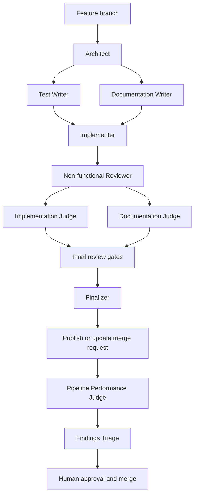

# OVA Agentic Flow copier

A [Copier](https://copier.readthedocs.io/) template for new Python projects.
It provides a modern Python toolchain and a portable, human-gated workflow for
Claude Code, Codex, and Pi. Generated projects support Python and, when
present, Bash-specific checks.

## Check the agent once

Check whether the agent can select work without changing the repository
or GitLab:

```bash
uv run agent-work run-next --json
```

## Run the agent once

After a human has authorized unattended publication and the safeguards are in
place, process one issue in a bounded pass:

```bash
uv run agent-work run-next --apply --json
```

For scheduled operation, safeguards, status checks, and troubleshooting, see
[Set up the serial GitLab agent loop](docs/how-to/setup-serial-gitlab-agent-loop.md).

## Check the scheduled agent loop

Check the timer and its most recent service activity:

```bash
if [[ -z "${XDG_RUNTIME_DIR:-}" || ! -S "${XDG_RUNTIME_DIR}/bus" ]]; then
  export XDG_RUNTIME_DIR="/run/user/$(id -u)"
  export DBUS_SESSION_BUS_ADDRESS="unix:path=$XDG_RUNTIME_DIR/bus"
fi

systemctl --user status agentic-copier-agent-work.timer agentic-copier-agent-work.service
journalctl --user -u agentic-copier-agent-work.service --since today
```

## Quick start

Install [UV](https://docs.astral.sh/uv/getting-started/installation/), Git,
and [`glab`](https://gitlab.com/gitlab-org/cli), then generate and test a
project:

```bash
uvx copier copy --trust ssh://git@gitlab-master.nvidia.com:12051/nvis-ova/nvis-ova-agentic-copier.git my-project
cd my-project
uv run pytest
```

`--trust` permits Copier to run this template's declared post-render tasks.
Review the [template contract](docs/reference/template-contract.md) for those
tasks, inputs, generated files, and update behavior. For a guided first run,
see [Create your first project](docs/tutorials/create-your-first-project.md).

## What you get

- UV-managed Python, Ruff, ty, pytest, tox, pre-commit, and GitLab CI.
- A `src/<package>/` project layout with starter tests and documentation.
- Bash syntax and ShellCheck validation when a project contains Bash.
- A portable, test-driven, human-gated agent workflow rooted in `.agents/skills`.
- A serial GitLab issue loop that creates merge requests but never approves or
  merges them.

## Agent workflow

Generated projects follow this workflow. `AGENTS.md` is the authoritative
manifest for exact skill routing and conditional instruction loading. Read [how
the agent workflow works](docs/explanation/agentic-workflow.md) for its design,
lifecycle, role boundaries, and validation details.



### Merge requests are the source of truth

GitLab merge requests are the shared record of a change: they show its proposed
diff, branch tip, pipeline results, review discussions, and current state.
Agents use that record to publish work, continue follow-up changes, and hand
the result to reviewers; a local branch or agent session is only a working
context. See [how merge requests coordinate agent work](docs/explanation/agentic-workflow.md#merge-requests-are-the-shared-record)
for the full explanation.

## Documentation

The [documentation index](docs/index.md) organizes the detailed material as
tutorials, how-to guides, reference, and explanation. It includes project
creation and updates, template validation, the loop setup, and the template
contract.

## Developing this template

Use [Validate template changes](docs/how-to/validate-template-changes.md) for
the repository's validation commands. Read [Why the template and generated
project are separate](docs/explanation/template-and-generated-project.md) for
the boundary between this repository and its generated output.
