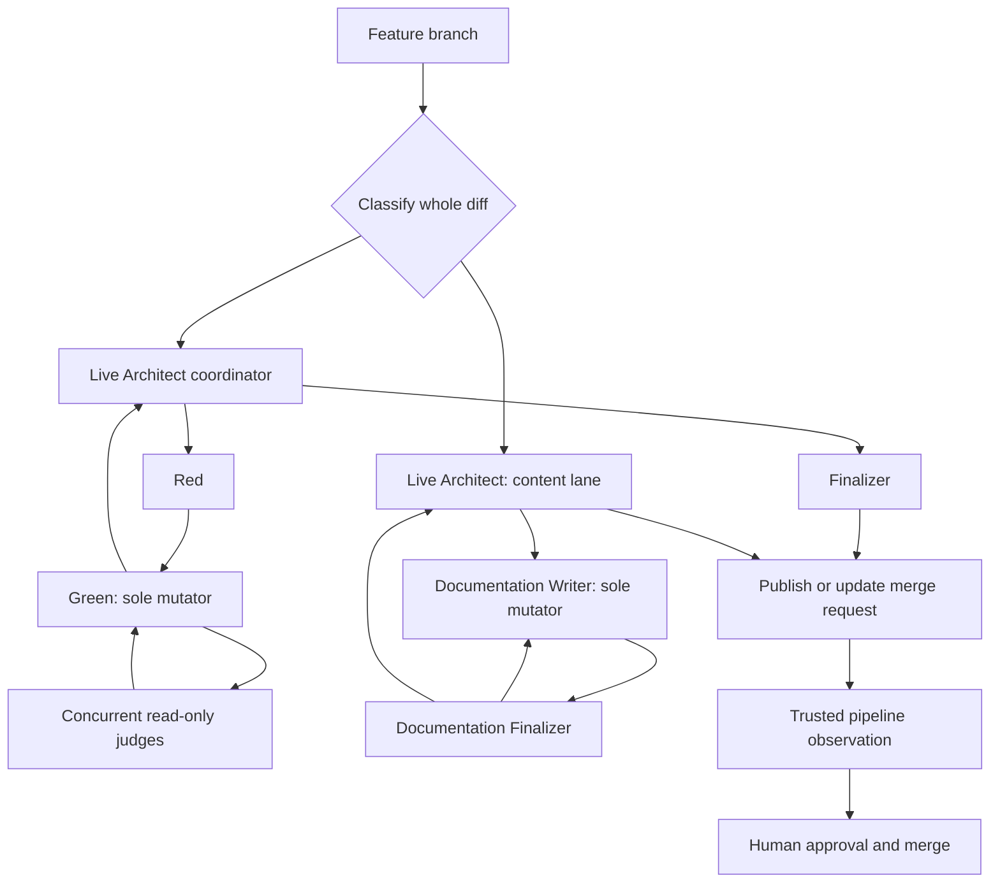

<!-- SPDX-FileCopyrightText: Copyright (c) 2026 NVIDIA CORPORATION & AFFILIATES. All rights reserved. -->
<!-- SPDX-License-Identifier: LicenseRef-NvidiaProprietary -->
<!--  -->
<!-- NVIDIA CORPORATION, its affiliates and licensors retain all intellectual -->
<!-- property and proprietary rights in and to this material, related -->
<!-- documentation and any modifications thereto. Any use, reproduction, -->
<!-- disclosure or distribution of this material and related documentation -->
<!-- without an express license agreement from NVIDIA CORPORATION or -->
<!-- its affiliates is strictly prohibited. -->
# OVA Agentic Flow copier

A [Copier](https://copier.readthedocs.io/) template for new Python projects.
It provides a modern Python toolchain and a portable, human-gated workflow for
Claude Code, Codex, and Pi. Generated projects support Python and, when
present, Bash-specific checks.

## Check the agent once

Check whether the agent can select work without changing the repository
or GitLab:

```bash
export AGENT_WORK_BASE_BRANCH=agent/work-base
uv run agent-work loop run --json
```

## Run the agent once

After a human has authorized unattended publication and the safeguards are in
place, process one issue in a bounded pass:

```bash
export AGENT_WORK_BASE_BRANCH=agent/work-base
uv run agent-work loop run --apply --json
```

By default, one activation advances one issue through up to 16 persisted
workflow attempts within one 10,800-second (three-hour) overall work budget.
Each workflow invocation receives the positive, ceil-rounded time remaining
from that same budget. A new issue attempts its full applicable workflow in one
worker session, while saved work resumes from its durable worktree and recorded
outer phase. Use `--max-segments` or `--max-activation-seconds` to tighten the
activation bounds.

The systemd wrapper keeps each Python activation bounded to one issue, continues
immediately for a due retry of that issue, and begins another issue only after a
terminal handoff and a fresh eligible preview.
It yields to the timer for an empty queue, pipeline or other future external
wait, repair, or a per-issue budget limit. Retryable worker failures continue
in the same activation. For scheduled operation, safeguards, status checks, and troubleshooting, see
[How to set up the recoverable serial GitLab agent loop](docs/how-to/setup-serial-gitlab-agent-loop.md).

## Preview an upstream finding

Validate a finding manifest locally, without GitLab access or writes. JSON emits
only structural fields, fingerprints, and copied-path/evidence-link counts:

```bash
uv run agent-work upstream-finding preview --manifest-file finding.yaml --json
```

## Check the scheduled agent loop

Check the timer and its most recent service activity:

```bash
if [[ -z "${XDG_RUNTIME_DIR:-}" || ! -S "${XDG_RUNTIME_DIR}/bus" ]]; then
  export XDG_RUNTIME_DIR="/run/user/$(id -u)"
  export DBUS_SESSION_BUS_ADDRESS="unix:path=$XDG_RUNTIME_DIR/bus"
fi

systemctl --user status agentic-copier-agent-work.timer agentic-copier-agent-work.service
journalctl --user -u agentic-copier-agent-work.service --since today
```

## Quick start

Install [UV](https://docs.astral.sh/uv/getting-started/installation/), Git,
and [`glab`](https://gitlab.com/gitlab-org/cli), then generate and test a
project:

```bash
uvx copier copy --trust ssh://git@gitlab-master.nvidia.com:12051/nvis-ova/nvis-ova-agentic-copier.git my-project
cd my-project
uv run pytest
```

`--trust` permits Copier to run this template's declared post-render tasks.
Review the [template contract](docs/reference/template-contract.md) for those
tasks, inputs, generated files, and update behavior. For a guided first run,
see [Create your first project](docs/tutorials/create-your-first-project.md).

## What you get

- UV-managed Python, Ruff, ty, pytest, tox, pre-commit, and GitLab CI.
- A `src/<package>/` project layout with starter tests and documentation.
- Bash syntax and ShellCheck validation when a project contains Bash.
- A read-only `scripts/check_licenses.py` policy checker, run by pre-commit and CI.
- A portable, human-gated agent workflow rooted in `.agents/skills`, with
  separate coding and documentation/agent-policy lanes.
- A recoverable serial GitLab issue loop that resumes active work first, then
  selects eligible fresh issues as high priority, no recognized exact priority
  label, then low priority;
  within each group it uses absolute creation time and IID. Eligibility still
  requires an open, non-confidential issue without a lifecycle projection or
  durable-ledger record; its trusted runner publishes only validated workflow results, creates merge
  requests, and never approves or merges them. Policy changes can publish after
  complete receipts and metadata; unresolved safe controversies require a
  `Draft:` handoff, while unsafe or incomplete evidence remains `needs_human`.

## Agent workflow

Generated projects classify each whole change into a coding lane or a
documentation and agent-policy lane. `AGENTS.md` is the authoritative manifest
for exact skill routing and conditional instruction loading. Read [how the
agent workflow works](docs/explanation/agentic-workflow.md) for its design,
lifecycle, role boundaries, and validation details.



For unattended work, one workflow-owning agent session preserves context from
Architect through Red, Green, concurrent review, consolidated repair, and
finalization. The trusted runner alone publishes and observes the exact source-
SHA pipeline; no post-publication agent invocation delays human handoff. Coding-
lane GitLab validation lists its nine gates as native jobs with individual green or red status indicators.
The root jobs use the repository's immutable prebuilt validation image without
runtime dependency setup. Python 3.11 and 3.14.3 retain separate suites, logs,
and coverage reports.

### Merge requests are the source of truth

GitLab merge requests are the shared record of a change: they show its proposed
diff, branch tip, pipeline results, review discussions, and current state.
Agents use that record to publish work, continue follow-up changes, and hand
the result to reviewers; a local branch or agent session is only a working
context. See [how merge requests coordinate agent work](docs/explanation/agentic-workflow.md#merge-requests-are-the-shared-record)
for the full explanation.

## Documentation

The [documentation index](docs/index.md) organizes the detailed material as
tutorials, how-to guides, reference, and explanation. It includes project
creation and updates, template validation, the loop setup, and the template
contract.

## Developing this template

Use [Validate template changes](docs/how-to/validate-template-changes.md) for
the repository's validation commands. Read [Why the template and generated
project are separate](docs/explanation/template-and-generated-project.md) for
the boundary between this repository and its generated output.
For the project-only validation image refresh and setup contract, see [Refresh
the CI dependency image](docs/how-to/refresh-ci-image.md).
