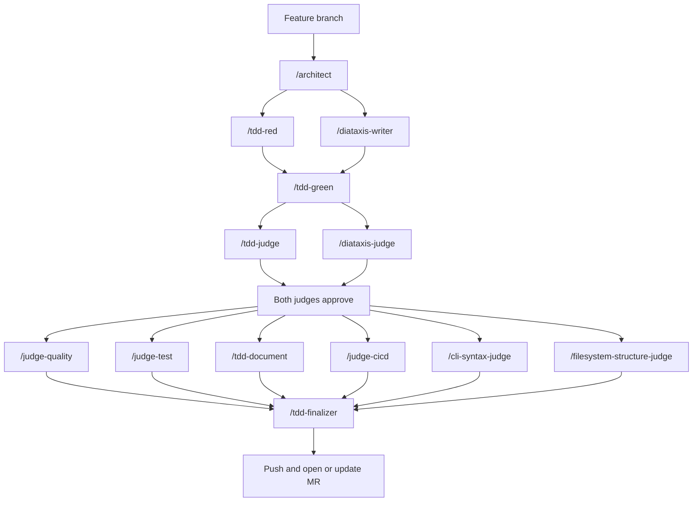

# OVA Agentic Flow copier

A [Copier](https://copier.readthedocs.io/) template that scaffolds new Python projects with a modern toolchain (UV, Ruff, ty, pytest, tox, pre-commit, GitLab CI) **and** a multi-agent Claude Code workflow wired in from day one. The workflow also recognizes Bash scripts in generated projects and applies Bash-specific checks when they are present.

If you're starting a new Python project on the team, this is the starting point. It saves you a day of boilerplate setup and gives you a TDD-enforced workflow with quality and CI gates pre-configured.

## Documentation

The [documentation index](docs/README.md) organizes deeper material using
[Diátaxis](https://diataxis.fr/): a first-project tutorial, task-focused
how-to guides, a template reference, and explanations of the template design
and [why it uses Diátaxis](docs/explanation/why-diataxis.md), as well as
[why its coding standards exist](docs/explanation/coding-standards.md).

## Serial GitLab agent loop

Generated projects use GitLab-only polling for one opted-in issue at a time.
Set `GITLAB_HOST` and a numeric `GITLAB_PROJECT_ID`; the loop addresses the
configured numeric project rather than inferring it from `origin`. A Developer
account can poll eligible issues, so no webhook or inbound service is required:

```bash
agent-work run-next --json
agent-work run-next --apply --json
```

An applied run uses a dedicated agent checkout, opens one MR, and
stops at `awaiting_human`. It never approves or merges. Enable the supplied
user-systemd timer only after a human explicitly authorizes unattended
publication, the service identity is constrained, and a Maintainer has verified
independent approval safeguards (a Developer `403` is inconclusive). See the
generated [how-to](template/docs/how-to/setup-serial-gitlab-agent-loop.md),
[reference](template/docs/reference/serial-gitlab-agent-loop.md), and
repository [setup skill](.agents/skills/setup-agent-loop/SKILL.md).

## What you get

Running this template produces a Python project that is ready to develop in immediately:

- **[UV](https://docs.astral.sh/uv/)** for dependency management and virtualenv (`uv sync`, `uv run …`).
- **[Ruff](https://docs.astral.sh/ruff/)** for linting and formatting, configured with `select = ["ALL"]` and curated exceptions.
- **ty** for type checking (Astral's fast type checker).
- **[pytest](https://docs.pytest.org/)** with `pytest-cov`, `pytest-mock`, `pytest-subprocess`, `pytest-timeout`, and `requests-mock`.
- **[tox](https://tox.wiki/)** with `tox-uv`, configured to run tests against **Python 3.11 and 3.14**.
- **[pre-commit](https://pre-commit.com/)** hooks: trailing-whitespace and TOML parsing checks, Bash syntax, [ShellCheck](https://www.shellcheck.net/), local Kingfisher secret scanning (no validation or update check), ruff (check + format), [yamllint](https://yamllint.readthedocs.io/), ty, tox.
- **GitLab CI** ([`.gitlab-ci.yml`](template/.gitlab-ci.yml)) with jobs for `ruff_check`, `ruff_format`, `pytest` (tox), `yamllint`, `kingfisher`, `type_check`, and `shellcheck`. Code quality and JUnit reports are wired into GitLab's UI.
- **Claude Code agentic workflow** — `.claude/agents/`, `.claude/commands/`, `docs/`, and a `CLAUDE.md` that routes feature work through architecture, TDD, Diátaxis documentation, judges, and finalization (see [Agentic workflow](#agentic-workflow) below).
- **Coding conventions** baked into `CLAUDE.md`: standard Python `src/<package>/` layout, a single public Bash `bin/<tool>` CLI backed by `src/` or `lib/`, pathlib over `os`, dataclasses, type annotations, docstrings on public APIs, functional style, `pytest.mark.parametrize` over duplication, no internal mocking, and safe-by-default state-mutating scripts (no changes without an explicit `--apply` flag).

## Prerequisites

The trusted setup checks that these commands are installed and stops before
project setup if one is missing:

- **UV** — install per [UV installation docs](https://docs.astral.sh/uv/getting-started/installation/). Everything here runs through `uv` and `uvx` — including Copier itself, which we invoke as `uvx copier` rather than installing globally. UV also fetches Python interpreters on demand and runs the post-generation `uv sync`.
- **Git** — `git init` is run automatically after generation.
- **[`glab`](https://gitlab.com/gitlab-org/cli)** — required by the generated
  GitLab workflow.

The generated project's Bash checks use Bash and
[ShellCheck](https://www.shellcheck.net/), but they do not block generation.
Install them before running those checks. Likewise, a Git identity and GitLab
access are checked as readiness diagnostics, not global prerequisites: Git
may resolve an identity from repository configuration or directory-scoped
environment variables (for example, through `direnv`), and `glab` may use a
directory-scoped token such as `GITLAB_TOKEN`.

The command check does not require a separately installed Python, Ruff,
pytest, or other project tool: UV manages the Python interpreter and project
tooling.

## Quick start

```bash
uvx copier copy --trust ssh://git@gitlab-master.nvidia.com:12051/nvis-ova/nvis-ova-agentic-copier.git my-project
cd my-project
uv run pytest
```

`--trust` is required because [`copier.yaml`](copier.yaml) declares `_tasks`
that execute on your machine after rendering. Copier refuses to run them
without explicit trust. Its first task is a prerequisite preflight; it runs
after rendering (a Copier limitation), but before `git init`, `uv sync`, or
pre-commit installation make setup changes.

You'll be prompted for three values (see [Template variables](#template-variables)). After the prompts, Copier runs the [post-generation tasks](#post-generation-tasks) and the development setup is complete. If the command preflight fails, install the named command and run the Copier command again. Address any Git identity or GitLab access diagnostic before making commits or using the GitLab workflow.

To regenerate a project later when this template gets new features, run `uvx copier update --trust` from inside the generated project — see [Updating an existing project](#updating-an-existing-project).

## Template variables

Defined in [`copier.yaml`](copier.yaml). Copier prompts for these interactively; you can also pass them via `--data key=value`.

| Variable       | Description                                          | Default                                                |
|----------------|------------------------------------------------------|--------------------------------------------------------|
| `project_name` | Human-readable project name                          | `My Python Project`                                    |
| `project_slug` | Python package name (importable)                     | auto-derived from `project_name` (lowercased, `_`-joined) |
| `description`  | One-line project description (used in `pyproject.toml`) | `A Python project generated with copier`            |

Non-interactive example:

```bash
uvx copier copy --trust ssh://git@gitlab-master.nvidia.com:12051/nvis-ova/nvis-ova-agentic-copier.git my-project \
  --data project_name="Order Service" \
  --data description="Order ingestion pipeline"
```

## Post-generation tasks

After rendering, Copier runs (configured in [`copier.yaml`](copier.yaml) under `_tasks`):

1. A command preflight — checks that `git`, `uv`, and `glab` are on `PATH`.
   A missing command stops the remaining setup tasks.
2. `git init` — initialize a git repository.
3. Readiness diagnostics — verify the Git identity Git resolves in the new
   repository and make an authenticated `glab api` request to
   `${GITLAB_HOST:-gitlab-master.nvidia.com}`. These checks support
   repository-local and `direnv`-scoped configuration, and report problems
   without blocking setup.
4. `uv sync` — create the venv and install dependencies.
5. `uv run pre-commit install` — install the git pre-commit hook.

Copier has already rendered files by the time it can run a task, so a failed
preflight can leave the destination directory behind. Correct the missing
command and re-run Copier; use a new or empty destination directory if Copier
will not reuse the existing one. A readiness diagnostic does not prevent
setup, but must be corrected before the corresponding commit or GitLab action.

## Generated project layout

```text
my-project/
├── .claude/
│   ├── agents/            # Claude Code agent definitions (architect, tdd-*, diataxis-*, judge-*)
│   ├── commands/          # Slash-command wrappers for the agents above
│   ├── project.md         # Project-specific Claude context (loaded by CLAUDE.md)
│   └── settings.json
├── .gitlab-ci.yml         # GitLab CI pipeline (ruff, pytest+tox, yamllint, ty)
├── .pre-commit-config.yaml
├── CLAUDE.md              # Conventions + agentic workflow instructions
├── bin/                   # Optional convention; add only for one public Bash <tool> CLI
├── docs/                  # Diátaxis documentation: tutorials, how-tos, reference, explanation
├── README.md              # Generated stub — fill in for your project
├── src/
│   └── my_project/        # Importable Python production code
│       └── __init__.py
├── tests/
│   ├── __init__.py
│   ├── conftest.py
│   └── helpers/
└── pyproject.toml         # ruff, pytest, coverage, tox, dependency groups
```

## Agentic workflow

The generated project ships with a Claude Code multi-agent workflow that enforces test-driven development and quality/CI gates for Python and Bash code. All agents are defined under `.claude/agents/` and exposed as slash commands under `.claude/commands/`.

The workflow detects the changed files before validation. Python uses `uv`, `ruff`, `ty`, `pytest`, and `tox`; Bash uses `bash -n` and ShellCheck. Mixed changes run both applicable paths. The judges use the matching language conventions, including strict Bash scripting, quoted expansions, safe mutation defaults, and isolated shell tests.

Before finalization, `/filesystem-structure-judge` verifies that Python
production code is in `src/<package>/` with tests in `tests/`, and that each
Bash application exposes one public `bin/<tool>` CLI backed by `src/` or
`lib/`. Any different layout must be documented in `.claude/project.md` with
the replaced rule, paths, and rationale.

CLI changes also pass `/cli-syntax-judge`, which applies the [Command Line
Interface Guidelines](https://clig.dev): one entry point, verb-based
subcommands, `--json`/`--help`/`--apply` support, dry-run safety by default,
non-interactive flag inputs, structured JSON output, and consistent exit codes.

> Background reading: [Claude Code overview](https://docs.claude.com/en/docs/claude-code/overview), [subagents](https://docs.claude.com/en/docs/claude-code/sub-agents), [slash commands](https://docs.claude.com/en/docs/claude-code/slash-commands).

### Git-flow lifecycle

Every change — TDD or trivial — wraps in the same lifecycle, documented in [`.claude/git-flow.md`](template/.claude/git-flow.md) and `@`-loaded from `CLAUDE.md` so the main agent always has it in context:

1. **Branch** — from a clean, up-to-date `main` (a clean working tree is required to start), the main agent creates `claude/<slug>` from the task description.
2. **Work** — either the TDD agents (below) or, for ≤~10-line trivial edits, a direct edit + commit.
3. **Publish** — before branching or publishing, the workflow proves both access paths with `git pull --ff-only` and a `glab api` query against the numeric `GITLAB_PROJECT_ID`. This supports either directory-scoped environment credentials or an existing VM Git/`glab` setup; it does not replace a working remote just to match a proxy environment. Then it uses `git push` and the project-ID API to create an MR (or just `git push` if one exists). Branch protection makes the MR mandatory — there is no direct-to-`main` path, even for a one-line fix.
4. **Hand off** — report the published work as `awaiting_human` and release the
   active checkout without waiting for merge. Human approval, merge, and a
   green post-merge pipeline still determine when the change is fully landed,
   but they do not block unrelated work. Preserve the feature branch for
   review feedback and delete it only after merge is confirmed.

Read-only inspection is the sole exception to this lifecycle. Every repository
mutation must finish by publishing its feature branch and opening or updating
an MR. A commit, authentication, push, or MR-creation failure is a blocker,
not a completed outcome.

The TDD agents below own the middle "work" phase only.

### Diátaxis documentation

[Diátaxis](https://diataxis.fr/) organizes documentation by the reader's need:
**Tutorials** teach a lesson, **How-to guides** complete a task, **Reference**
supports accurate lookup, and **Explanation** builds understanding. Generated
projects include [`docs/diataxis.md`](template/docs/diataxis.md), which defines
the documentation process and keeps these four kinds of content distinct.

### Routing (TDD work phase)

Mermaid flowcharts are recommended when a workflow has relationships that are
hard to scan in prose or a text diagram.



### Agents

| Command           | Role                                                                                                  | Does **not**                                |
|-------------------|-------------------------------------------------------------------------------------------------------|---------------------------------------------|
| `/architect`      | Designs modules, data structures, dependency boundaries                                               | Write code or tests                         |
| `/tdd-red`        | Writes failing tests; stops at Red                                                                    | Touch implementation                        |
| `/diataxis-writer`| Creates or updates `docs/` content as a Tutorial, How-to guide, Reference, or Explanation            | Touch code, tests, or README.md             |
| `/tdd-green`      | Minimal implementation to reach Green                                                                 | Refactor or add untested features           |
| `/tdd-judge`      | Runs applicable Python/Bash lint + non-test pre-commit checks                                          | Fix issues — rejects and routes back        |
| `/diataxis-judge` | Read-only validation that `docs/` is accurate and fits its Diátaxis category                          | Edit docs, code, tests, or README.md        |
| `/judge-quality`  | Pure code review: design, clarity, conventions; tags findings **Major** / **Minor** / **Existing**    | Run any tooling                             |
| `/judge-test`     | Pure test-quality review (Sonnet): meaningful assertions, parametrize, hypothesis, order-independence, no internal mocking; tags **Major** / **Minor** / **Existing** | Run any tooling; review production code     |
| `/tdd-document`   | Ensures `README.md` accurately orients people landing on the project                                  | Touch `docs/`, code, tests, or agent definitions |
| `/judge-cicd`     | Verifies `.gitlab-ci.yml` is in sync with the change and checks pipeline health via [`glab`](https://gitlab.com/gitlab-org/cli) | Edit CI config or retry pipelines           |
| `/cli-syntax-judge` | Validates CLI changes against [CLIG](https://clig.dev) and the required safety, output, and exit-code contracts | Run tooling or edit files |
| `/filesystem-structure-judge` | Verifies the Python/Bash filesystem layout or a documented project-specific deviation | Edit files, run tooling, or review non-layout quality |
| `/tdd-finalizer`  | Verifies README sync, runs applicable Python/Bash gates, commits locally; the orchestrator then follows [`git-flow.md`](template/.claude/git-flow.md) Steps 3–4 (push + MR via [`glab`](https://gitlab.com/gitlab-org/cli); hand off without waiting for merge) | Fix issues — rejects and routes back        |

**Two non-negotiable rules:**

1. Never write implementation before a failing test exists.
2. Never merge without all validators approving.

### Quality finding severity

The two quality reviewers — `/judge-quality` (production code) and `/judge-test` (tests) — classify every finding as one of:

- **Major** — defect in this change. The judge returns `Overall: Reject` and the orchestrator reroutes automatically: `/judge-quality` to `/tdd-green`, `/judge-test` to `/tdd-red` (test defects belong to the Test Writer).
- **Minor** — non-blocking style or clarity nit caused or kept by this change. The main agent files it with the GitLab Bug template and links it from the merge request.
- **Existing** — pre-existing issue in surrounding code or tests that this change did not introduce. Surfaced in the report but not automatically filed.

**Minor and Existing findings never block the merge.** Deferred quality work and user-directed follow-ups are tracked as GitLab issues, created from the Bug and Feature templates in `.gitlab/issue_templates/`. Each issue records priority (`P0`–`P3`) and severity (`S1`–`S4`), so urgency and impact are visible separately.

### Using the workflow

In a Claude Code session opened against the generated project:

```text
/architect add a CSV ingestion module that streams rows into the existing pipeline
```

Claude designs the module, then `/tdd-red` and `/diataxis-writer` run together. After implementation, `/tdd-judge` and `/diataxis-judge` run together before the remaining gates, including `/cli-syntax-judge`. When a judge rejects, the workflow reroutes automatically — no approval prompt — until the gates pass.

The same agents and commands also live in **this** repo's `.claude/`, so you can dogfood the workflow while developing the template itself.

## Updating an existing project

Copier remembers the answers in `.copier-answers.yml` inside the generated project. To pull in template improvements:

```bash
cd my-project
uvx copier update --trust
```

Copier produces a 3-way merge against your local changes. Files listed under `_skip_if_exists` in [`copier.yaml`](copier.yaml) (e.g. `pyproject.toml`, `README.md`, `.gitlab-ci.yml`, `.claude/project.md`, the package's `__init__.py`) are **not** overwritten on update — your project's customizations are safe. Legacy flat packages receive an update warning and must be migrated manually before updating. See [Copier's update docs](https://copier.readthedocs.io/en/stable/updating/) for conflict-resolution details.

## Developing this template

The structure of this repo:

- `copier.yaml` — variables, post-generation tasks, skip-if-exists list.
- `template/` — the template payload. Files with `.jinja` get rendered and the extension stripped (`pyproject.toml.jinja` → `pyproject.toml`). Paths containing `{{ … }}` are also rendered (e.g. `src/{{ project_slug }}/__init__.py`).
- `tests/test_template.py` — exercises template generation via `copier.run_copy()` and inspects the output.
- `CLAUDE.md` (root) vs. `template/CLAUDE.md` — **separate files**. The root one applies when working on the template; the template one is what gets copied into generated projects.

```bash
# Run the template's own tests
uv run tox                  # All Python versions
uv run pytest               # Faster iteration

# Lint and format
uv run ruff check --fix
uv run ruff format
uv run ty check

# Pre-commit
uv run pre-commit run --all-files

# Bash scripts (when present)
bash -n path/to/script.sh
shellcheck path/to/script.sh
```

Conventions for changes to this repo are in [`CLAUDE.md`](CLAUDE.md) — same agentic workflow applies.

## References

- [Copier documentation](https://copier.readthedocs.io/)
- [UV documentation](https://docs.astral.sh/uv/)
- [Ruff documentation](https://docs.astral.sh/ruff/)
- ty (type checker)
- [pytest](https://docs.pytest.org/)
- [tox](https://tox.wiki/)
- [pre-commit](https://pre-commit.com/)
- [Claude Code documentation](https://docs.claude.com/en/docs/claude-code/overview)
- [GitLab CI/CD](https://docs.gitlab.com/ci/)
- [`glab` CLI](https://gitlab.com/gitlab-org/cli)
