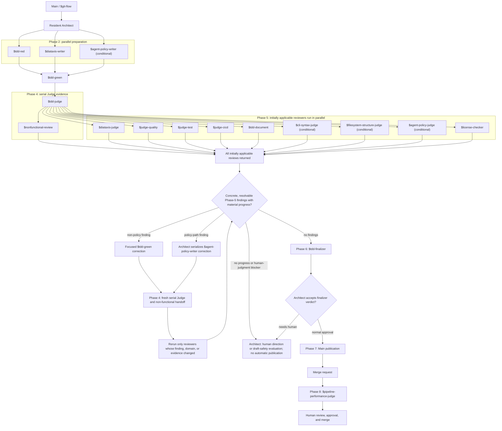
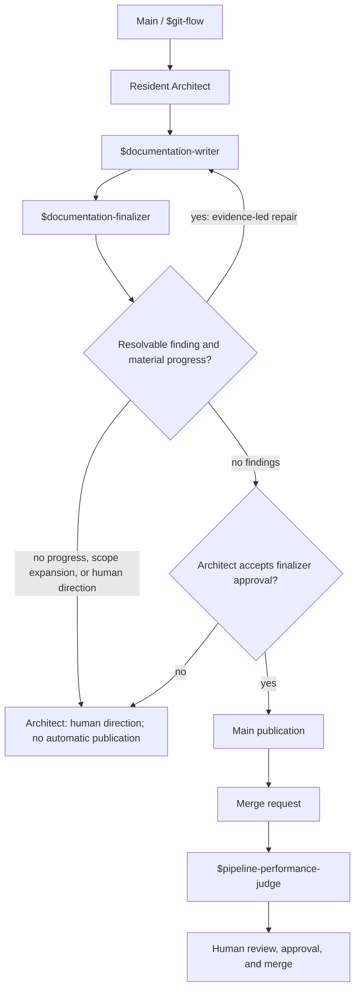
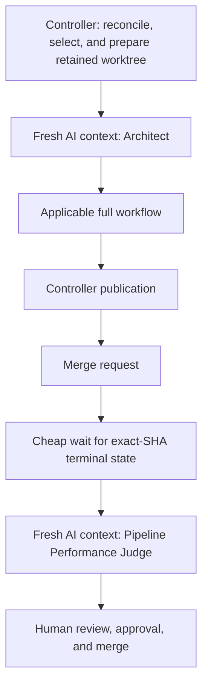
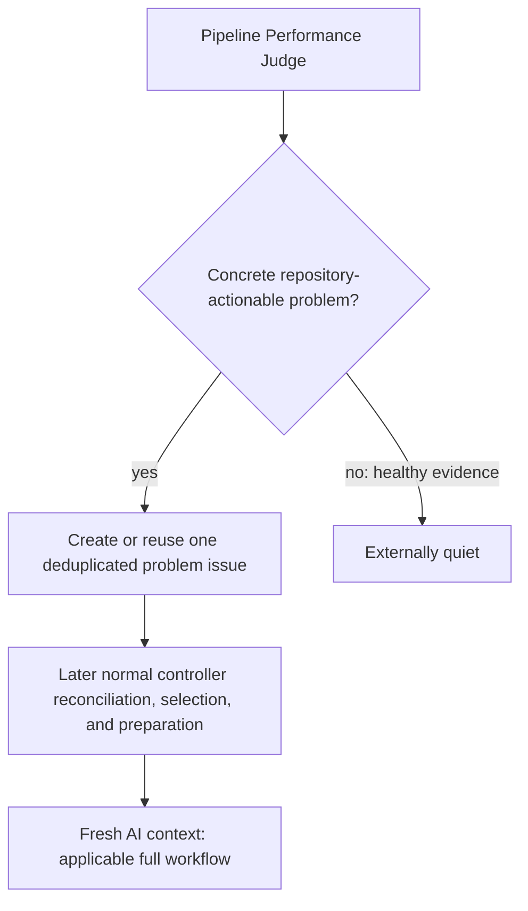
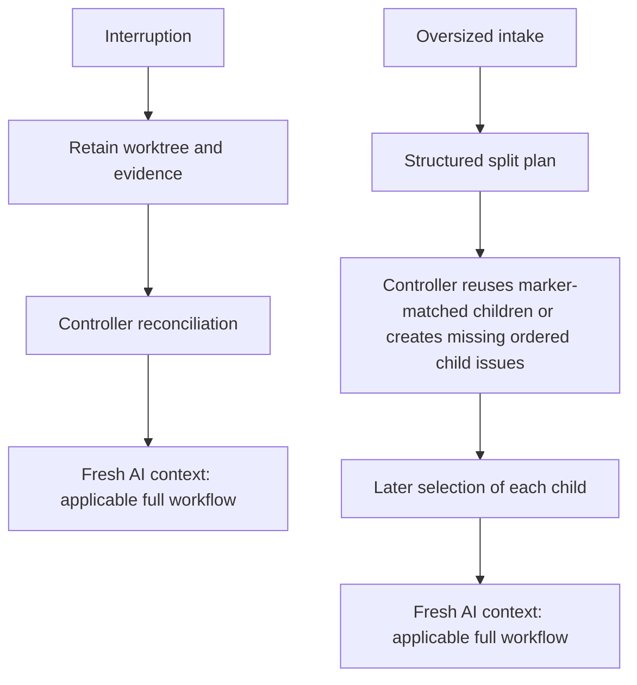

<!-- SPDX-FileCopyrightText: Copyright (c) 2026 NVIDIA CORPORATION & AFFILIATES. All rights reserved. -->
<!-- SPDX-License-Identifier: LicenseRef-NvidiaProprietary -->
<!--  -->
<!-- NVIDIA CORPORATION, its affiliates and licensors retain all intellectual -->
<!-- property and proprietary rights in and to this material, related -->
<!-- documentation and any modifications thereto. Any use, reproduction, -->
<!-- disclosure or distribution of this material and related documentation -->
<!-- without an express license agreement from NVIDIA CORPORATION or -->
<!-- its affiliates is strictly prohibited. -->

# Why the agent workflow uses specialized roles

This page explains how the generated multi-agent workflow turns a change into
a human-reviewed merge request without leaving role selection to a frontend's
interpretation. It is an explanation of the routing model; the authoritative
step-by-step manifest is `AGENTS.md`.

The workflow separates design, test design, documentation, implementation, and
review so every step has a clear purpose and an independent check. It has two
lanes: the coding lane for behavior or machine-readable-contract changes, and
the documentation and agent-policy lane for content-only changes. Roles are
portable across Claude Code, Codex, and Pi because the shared entry points are
the directories under `.agents/skills/`, not frontend-specific agents or
configuration. A display name such as “Test Writer” helps a reader understand
the phase, but it is never a routing identifier. The exact `$skill-id` named
by the manifest is the only identifier an agent may load or delegate.

Capacity is a launch-scoped workflow precondition, not a repository setting.
Each new workflow-owning session uses trusted frontend or runtime metadata for
that active launch. It selects the lane, calculates the exact required total,
and checks the current available total immediately before nested delegation or
worktree mutation. The coding lane needs at most 12 live slots: Main,
Architect, Green, and 9 initially applicable Phase-5 reviewers. The nested
Judge and Non-functional Reviewer require five live slots. A Phase-2 policy
writer makes that phase five slots as well: Main, Architect, Red, Diátaxis
Writer, and Agent-policy Writer. It does not widen the 12-slot coding maximum.
The documentation and agent-policy lane needs three live slots.

This boundary matters most during recovery. A retained worktree and ledger can
preserve work and record the previous capacity decision, but they cannot prove
capacity for a new session. An ordinary relaunch, retained-worktree retry, or
systemd-started worker must recheck current metadata. New consistent evidence
replaces the earlier observation. Missing, stale, conflicting, or insufficient
evidence stops before nested work and produces a `needs_human` handoff with the
lane, required total, available total or `unknown`, shortfall or `unknown`, and
a remedy for the active frontend.

Repository files, task or issue text, user settings, and provider-specific
configuration remain non-authoritative. They can describe or configure a
limit, but only the active frontend or runtime can attest what the current
session can use. This fail-closed check preserves the declared parallel phase
instead of silently serializing it. For the operator procedure and examples,
see [Configure agent capacity](../how-to/configure-agent-capacity.md).

`AGENTS.md` is intentionally a concise routing manifest rather than a second
copy of every role procedure. It says which file or skill to read, when it
applies, who owns the work, which capability tier to use, what evidence the
phase produces, and where a rejection goes. The selected skill then links to
the detailed role reference. This division keeps the portable decision visible
at session start while keeping role procedures in one maintained location.

## Two lanes keep validation proportional

The coding lane is the default for a whole diff that changes executable code,
tests, CI, packaging, configuration, schemas, command contracts, or executable
automation. It uses the full TDD route: architecture, Red, Green, timing
review, validation, and the applicable implementation, test, CI, CLI, and
filesystem reviews. Red and the Diátaxis Writer prepare disjoint phase-2 test
and documentation changes in parallel. When a mixed coding change also touches
portable agent policy, the Agent-policy Writer joins them. Green then implements
the production change and reconciles the documentation with behavior, tests,
and final interfaces; it does not edit agent-policy paths.

In Phase 3, Green first runs the fast formatter, lint, and type checks, runs
focused behavior tests, stages one exact candidate, and records its tree OID.
In serial Phase 4, the TDD Judge runs the installed pre-commit hook through Git
against that staged candidate. Its unchanged tree OID and every supported-version
JUnit artifact's SHA-256 digest and test count are prerequisites for its
Non-functional Reviewer child and then the nine concurrent Phase-5 reviews. In
Phase 6, Finalizer may commit with `--no-verify`
only after matching that exact evidence; the serial runner uses its ordinary
commit path. Phase-8 pipeline observation after Phase-7 push independently
checks the exact source commit; it never substitutes for the Judge.

In interactive work Finalizer makes the verified local
commit, then the main thread pushes and creates or updates the merge request.
For serial work Finalizer does not commit; the trusted controller's ordinary
Git commit retains its hook.

The documentation and agent-policy lane is for a whole diff limited to
documentation and the instructions that govern agent work. It does not invent
passing tests for prose. Instead, its writer identifies the source of truth,
records the files and mirrors changed, and validates structure: Markdown,
links and anchors, Diátaxis metadata and indexes, skill and manifest
references, and Copier rendering where a template is affected. Reviewers also
compare claims about supported versions, test commands, CI, and shell behavior
to their actual configuration and source. This checks that documentation stays
in sync without making a test suite assert wording.

The route is selected from the complete proposed diff, not from a file chosen
to describe it. A mixed diff, executable Markdown fence, or uncertainty uses
the coding lane. Agent-policy changes are never treated as trivial: changing a
route, authority boundary, or validation requirement can change how later
work is performed even when the edit is small.

Both lanes preserve the same publication boundary. They establish a feature
branch through Git flow, retain receipts for required or explicitly
not-applicable phases, publish a merge request, and leave approval and merge
to a human. The documentation lane substitutes content and policy validation
for Red, Green, JUnit timing, and code-focused judges; it does not skip the
merge-request record or human review.

## Loading is a decision, not an import side effect

Every session reads `AGENTS.md` and `.agents/project.md` before repository
work. The contribution-policy marker check is also mandatory; a failed check
loads `$repository-setup` before any other repository action. These are the
small shared context needed to understand the repository and its guardrails.

Language and process guidance are conditional. Python guidance applies when
the intended change includes Python, Bash guidance when it includes Bash,
Markdown guidance when it includes Markdown, and Python-testing guidance when
the work writes or reviews the relevant Python tests. TDD guidance applies to
the coding workflow, while content guidance applies to documentation and
agent-policy work. The manifest defines the classification boundary so an agent
does not load a full change workflow for a small, isolated correction or skip
it for a behavior-changing change.

The routing is written as imperative reads, not `@...` includes. Such includes
are not a portable recursive-loading mechanism across the supported frontends:
some hosts ignore them, while others can load an unrelated language guide on
every session. Conditional paths in the manifest make both the required and
unrequired context explicit.

Pi receives the repository's `.agents/skills` directory explicitly when the
serial worker starts it. This prevents project-trust discovery from silently
dropping the shared workflow. Claude Code uses the checked-in compatibility
link, and Codex discovers the shared skill tree, but each still follows the
same manifest and exact IDs.

The workflow is deliberately human-gated. Agents can prepare and publish a
merge request, but they do not approve or merge it. The serial GitLab loop
keeps the same boundary when it processes an issue.

## Workflow topology

The diagrams show the normal clean-publication path and the separate stops
that require human direction. A resident parent remains live while its child
roles work. A fresh-context node is a deliberately new AI context, not a
continuation of an interrupted agent.

The coding review fan-out includes the License Checker as an initial,
read-only Phase-5 reviewer. The Non-functional Reviewer is instead the TDD
Judge's read-only Phase-4 child. Every Phase-5 reviewer examines the same stable
post-Green diff, and Green waits for every initial receipt before consolidating
findings; a license receipt never depends on another review receipt. A license
violation re-enters focused correction with the other actionable findings. The
checker reruns only if maintained files in its checked scope changed. Final
validation requires a current approving license receipt for the final in-scope
diff: a violation cannot be waived or marked not applicable. A Draft
publication, when an explicit draft-safety verdict permits it, remains a
separate human handoff rather than an automatic consequence of a stop.

The ordinary interactive branch convention is `clanker/<slug>`. The serial
controller reserves `agent/issue-<iid>` for its issue worktrees. These names
identify the two contexts; this explanation does not claim a separate runtime
branch-enforcement mechanism.

For non-trivial coding work, the manifest names every phase rather than rolling
them up as “final judges.” Each manifest records phase applicability, ownership,
prerequisites, receipts, and reroutes. Delegated phases use the exact tier
and Codex model/effort named by their row. In Codex those tiers resolve to
`gpt-5.6-sol` / `high` for most-capable work, `gpt-5.6-terra` / `medium` for
balanced work, and `gpt-5.6-luna` / `low` for focused checks. Other supported
frontends resolve only their enabled equivalent; Frontier is never a fallback.

For coding work, the Architect owns one workflow session rather than launching
an unrelated top-level process for each phase. It hands its design concurrently
to Red and the Diátaxis Writer. When portable agent policy is in scope, it also
hands the approved policy boundary to the conditional Agent-policy Writer. Red
exclusively mutates `tests/`; the Diátaxis Writer exclusively mutates `docs/`,
including required indexes and reciprocal links; and the Agent-policy Writer
exclusively mutates `AGENTS.md`, `.agents/**`, and their declared portable
`template/` mirrors. Architect waits for every applicable receipt, or its exact
not-applicable record, before handing Green the design, Red test diff, Diátaxis
draft/report or no-doc rationale, and policy-writer receipt. Green implements
production and test changes, reconciles documentation, fans out the applicable
read-only judges, repairs its owned actionable feedback, and consolidates the
results for the Architect. Green never edits agent-policy paths or their
mirrors.

For coding work, Green makes required README and documentation edits before
the read-only review fan-out; no second agent mutates the shared worktree. In
the documentation and agent-policy lane, Architect delegates one Documentation
Writer as the sole mutator, followed by one consolidated Documentation
Finalizer. Evidence-based writer/finalizer repair and finalization cycles may
continue while they make material progress; a repeated finding, unchanged
evidence, or scope expansion returns to Architect for human direction. Neither
lane has an arbitrary repair count.

Phase-2 documentation is an approved-design draft, not a promise about code
that has not yet been written. Before review, Green compares and reconciles it
with the final code, configuration, and interfaces. The Diátaxis Judge then
explicitly compares the Architect design, writer report, final documentation,
and final implementation/configuration; the Finalizer requires that comparison
receipt. Every declared root/template mirror must be byte-identical, and a
changed Copier mirror must be smoke-rendered.

## Coding review convergence is bounded by evidence

Green makes evidence-led consolidated correction cycles while material progress
exists. A concrete
finding identifies its owner or domain, path or scope, evidence, requested
outcome, and a correction that stays within the approved design and authority.
By contrast, policy or authority ambiguity, conflicting valid requirements or
reviewers, acceptance controversy, a project-owned value change, and scope
expansion require human judgment.

Green consolidates every Phase-5 finding before it routes a correction. A
policy-path finding goes through the still-live Architect to the Agent-policy
Writer. Architect serializes that correction owner with Green, so Green never
repairs policy. Every changed candidate then follows the fresh Judge, applicable
review, and Finalizer sequence.

The Architect may request another focused Green invocation only while the
cycle ledger demonstrates material progress, not for a fixed number of tries.
The ledger records a cycle identifier; stable finding fingerprints and
classifications; changed paths or scope; checks before and after (or N/A);
reviewers rerun and why; and open, closed, and new findings with a continuation
or termination reason. A fingerprint combines reviewer or owner, path or
scope, and stable summary or requested outcome. Progress closes a prior
finding or materially changes relevant evidence without reopening the same
closed finding. Repetition, unchanged evidence, an unavailable approved-scope
correction, scope expansion, or genuine controversy stops the loop rather than
relabeling a finding to create apparent progress.

The first review includes every applicable reviewer, including the License
Checker. A correction reruns only the reviewer whose finding was addressed or
whose domain/evidence changed; the License Checker reruns when maintained files
in its checked scope changed, and the full test gate runs only when behavior or
tests changed. The Finalizer requires a current approving license receipt for
the final in-scope diff; a license violation cannot be waived or marked not
applicable. When a safe diff stops at a human judgment boundary, the Finalizer
can give a draft-safety verdict. That can hand off a
clearly titled `Draft:` merge request containing unresolved findings, the
evidence/cycle ledger, exact human decisions, tests, and unchanged project-owned
values. It is not merge approval. Unsafe or unvalidated work, or unclear
publication authority, returns to a human without publication. A normal
Finalizer approval and a draft-safety verdict are distinct handoffs: Architect
can accept the latter only to publish or update the labeled Draft: proposal for
human judgment. Existing merge requests retain their required closing content
and are read back after their title and description are updated. The normative
routing and publication rules remain in `AGENTS.md` and `git-flow`.

The CLI and filesystem judges are conditional only because their subjects can
be absent. Skipping either requires an explicit receipt in the applicability
record, for example `$cli-syntax-judge: not applicable — no CLI surface or
contract changed` or `$filesystem-structure-judge: not applicable — no
Python/Bash layout or packaging changed`; silence is not a skip. The Finalizer
validates every required completion and every permitted not-applicable receipt
before it allows publication. This preserves a complete record without running
a judge against a change that cannot affect its contract or layout.

## Publication and post-publication evidence

After every merge-request creation or update, a fresh Fast/low Pipeline
Performance Judge observes that MR's exact source SHA. Healthy evidence causes
no external mutation. A concrete, repository-actionable problem creates or
reuses one deduplicated GitLab issue; the judge never directly changes the MR,
code, pipeline, approval, or merge. Unverified evidence remains a reported
limitation, not manufactured repository work.

In the serial flow, the deterministic controller cheaply waits for the exact
SHA to become terminal before the fresh judge starts. A resulting problem issue
is selected later by normal reconciliation and begins a new full workflow
context. This is intentionally not a promise of direct same-session repair.
Agents never approve or merge, and they never change project-owned values or
workflow policy merely to clear a gate without explicit human approval for that
exact change.

## Merge requests are the shared record

A local branch and an agent session are working contexts, not the durable
record of a change. The GitLab merge request is the shared source of truth: it
records the proposed diff, branch tip, pipeline results, review discussions,
approvals, conflicts, and whether the change is open, merged, or closed.

Agents therefore interact with the merge request throughout the handoff. They
open or update it after publishing a feature branch, use its reported state to
decide whether follow-up work belongs on that branch, and return it to human
review after a repair. A new session does not infer completion from a local
checkout or a prior conversation; it checks the merge request. This keeps
review and publication visible to every collaborator and preserves the human
approval and merge boundary.

## Roles

| Role | Responsibility | Does not |
| --- | --- | --- |
| Architect | Owns the coding workflow session, design, context handoff, and final decision | Write production changes or tests |
| Remediator | Establishes an evidence-backed standards baseline and sequences fixes | Edit files, weaken standards, or declare skipped gates passing |
| Test Writer | Writes failing tests and stops at Red | Touch implementation |
| Diátaxis Writer | Coding-lane `docs/` owner running alongside Red; drafts documentation for Green to reconcile | Change executable scope, tests, README, or agent policy |
| Agent-policy Writer | Conditional coding-lane owner for `AGENTS.md`, `.agents/**`, and declared portable template mirrors | Change tests, docs, or production paths; let Green repair policy |
| Documentation Writer | Architect-delegated editor confined to the content-only documentation and agent-policy lane | Change executable scope or manufacture behavior tests |
| Implementer | Green's production, test, and documentation owner after Phase 2; reads the diff and consolidates judge feedback | Edit agent-policy paths or waive failed review evidence |
| Non-functional Reviewer | Reviews test timing and performance evidence before final validation | Rerun tests, edit code, or wait for finalization |
| Implementation Judge | Runs applicable Python/Bash lint and non-test checks | Fix issues |
| Diátaxis Judge | Validates documentation accuracy and Diátaxis fit | Edit docs, code, tests, or README.md |
| Agent Policy Judge | Reviews agent routing, portable skills, mirrors, and authority boundaries | Edit instructions, code, tests, or README.md |
| Quality Judge | Reviews production-code design, clarity, and conventions | Run tooling |
| Test Judge | Reviews test quality and language-appropriate test practices | Run tooling or review production-code quality |
| README Reviewer | Ensures the README orients new visitors | Touch docs, code, tests, or agent definitions |
| CI/CD Judge | Checks local CI configuration alignment and static job shape | Inspect live GitLab CI or edit configuration |
| CLI Judge | Checks CLI changes against safety, output, and exit-code contracts | Run tooling or edit files |
| Filesystem Judge | Checks the project layout or documented exceptions | Edit files, run tooling, or review non-layout quality |
| License Checker | Independently checks license compliance on the stable post-Green diff | Edit files, wait for another review receipt, or waive a violation |
| Finalizer | Verifies final gates and returns the final validation receipt | Fix issues or publish changes |
| Documentation Finalizer | Verifies content classification, structure, mirrors, and source synchronization | Edit, stage, publish, or call remote APIs |

The role boundaries prevent one step from silently marking its own work as
complete. They are workflow controls, not a same-user security boundary; GitLab
branch protection and human review remain the final controls.

## The serial worker has narrower authority

The serial `agent-work` worker uses the same manifest and explicit skill
directory, but it is not a normal repository author. It only edits and
validates its already-prepared branch. The trusted runner, rather than the
worker, commits, pushes, creates or updates the merge request, and hands it to
human review. Neither participant approves or merges. Keeping publication in
the trusted runner lets the worker execute the technical route without gaining
authority to cross the human review boundary.

For the serial worker's exact lifecycle and command contract, see the
[serial GitLab agent-loop reference](../reference/serial-gitlab-agent-loop.md).
