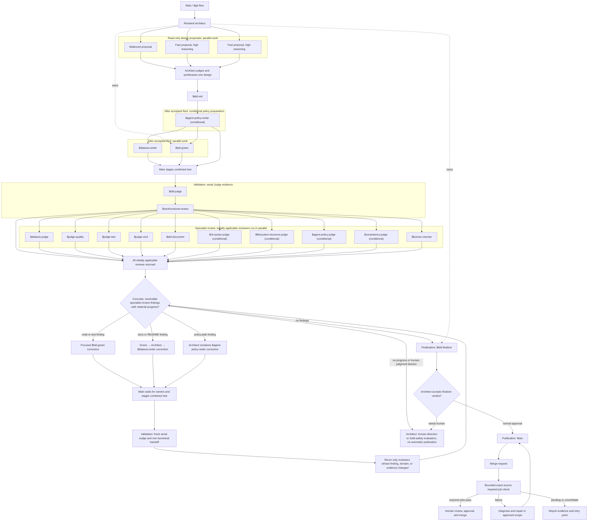
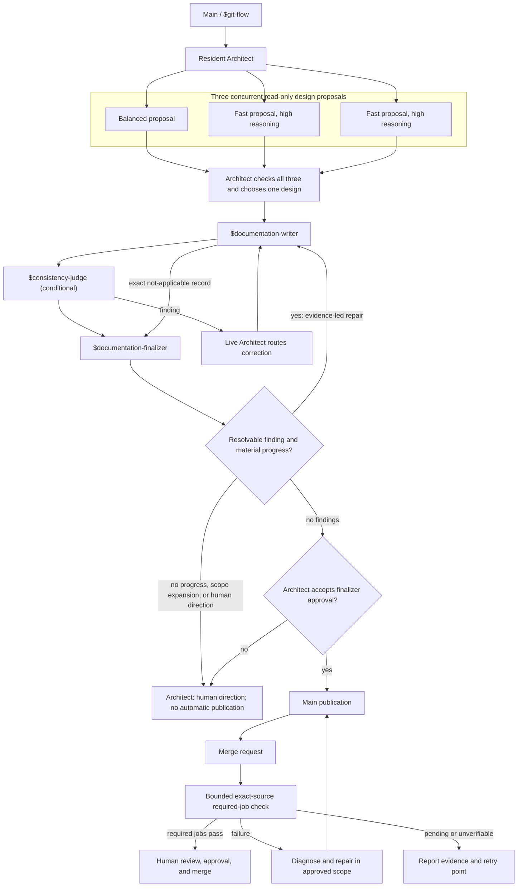
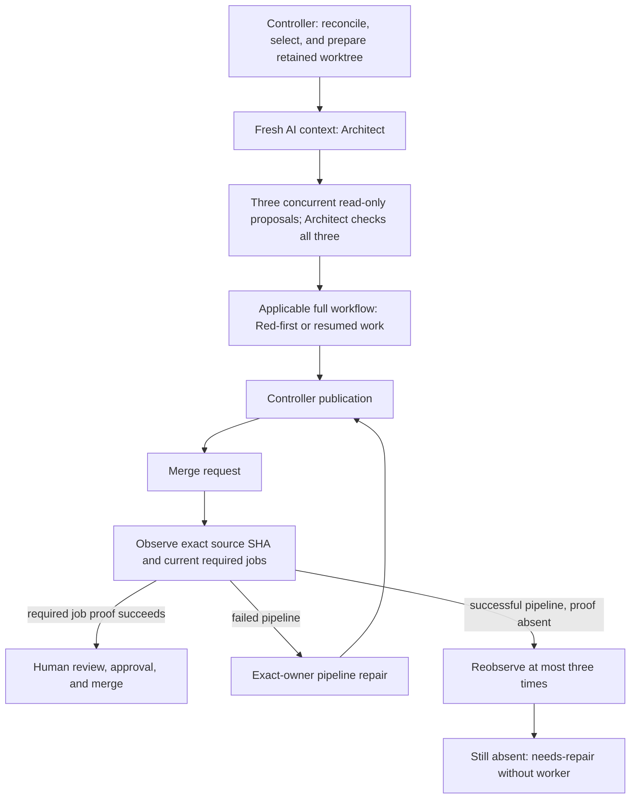
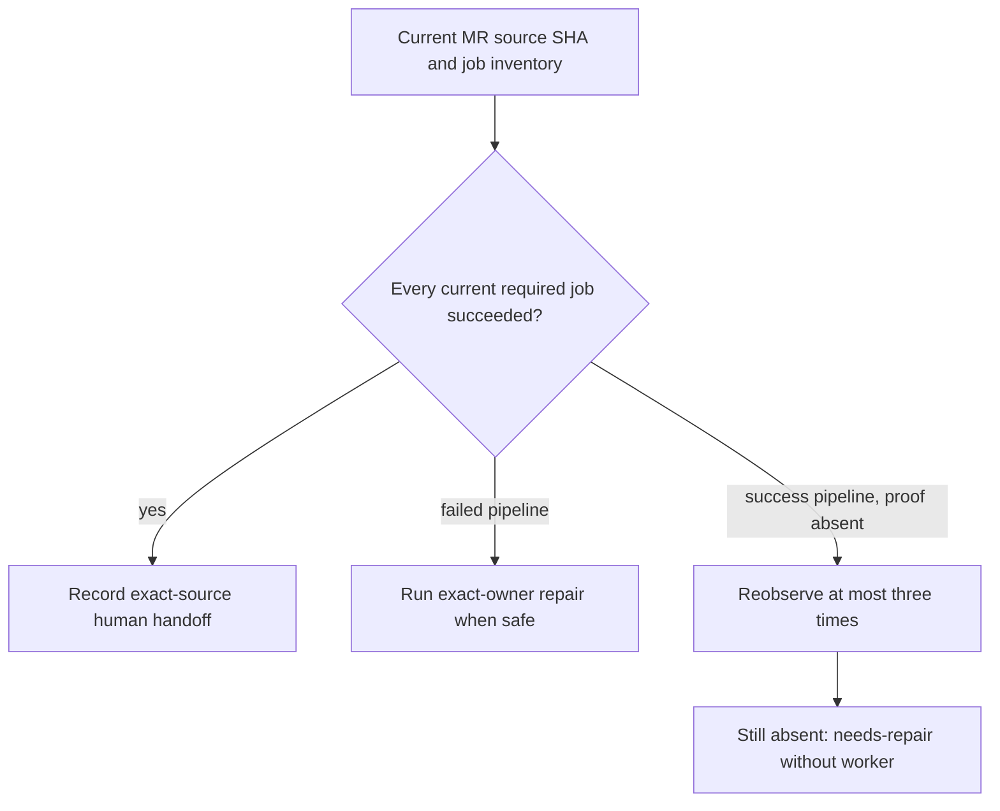
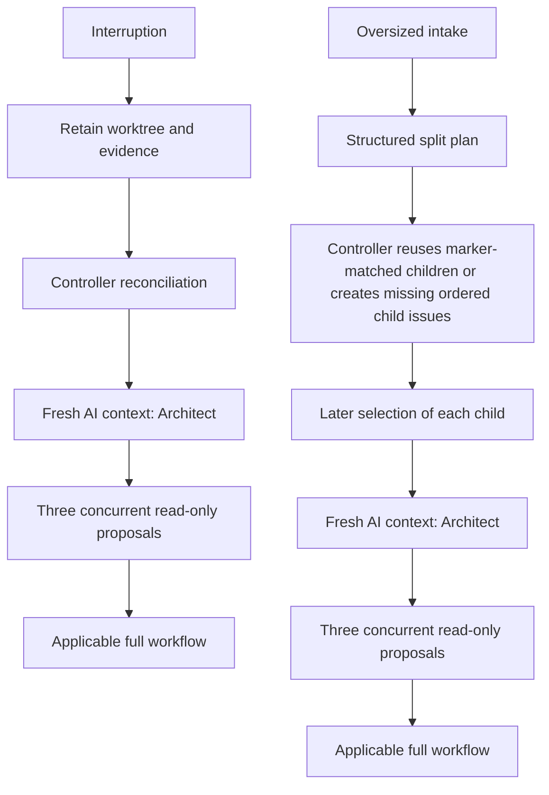

<!-- SPDX-FileCopyrightText: Copyright (c) 2026 NVIDIA CORPORATION & AFFILIATES. All rights reserved. -->
<!-- SPDX-License-Identifier: LicenseRef-NvidiaProprietary -->
<!--  -->
<!-- NVIDIA CORPORATION, its affiliates and licensors retain all intellectual -->
<!-- property and proprietary rights in and to this material, related -->
<!-- documentation and any modifications thereto. Any use, reproduction, -->
<!-- disclosure or distribution of this material and related documentation -->
<!-- without an express license agreement from NVIDIA CORPORATION or -->
<!-- its affiliates is strictly prohibited. -->

# Why the agent workflow uses specialized roles

This page explains the route from a change to a human-reviewed MR.
`AGENTS.md` is the portable bootstrap. The live `$architect` router in
`.agents/agents/architect.md` owns the workflow.

The route is clear. It names each role, check, and stop. Each role has one job.
Each check has one clear aim.

The workflow has two lanes. Coding covers behavior and machine-readable
contracts. Documentation and agent policy cover content-only changes. Shared
`.agents/skills/` directories work with Claude Code, Codex, and Pi. A display
name explains a role. The manifest's exact `$skill-id` is the only ID an agent
may load or delegate.

Architect checks capacity at launch. This check still runs after a serial
wrapper passes preflight and starts Architect. Each lane has one fixed global
limit: coding needs 12 live slots, while docs and agent-policy work needs 5.
Run the check before delegation, fan-out, or a worktree change.

Only a trusted current report can show free global slots. It must come
from the active frontend or runtime. If it reports at least the lane limit, admit
the lane. If it reports less, stop. Continue when global capacity is not
reported. Missing capacity facts do not prove a shortage.

For this check, do not make another limit from route shape, topology, or
retained-agent counts. Do not use current use, fresh handles, or parent and
child space. These facts do not control admission or create a second capacity
gate. A real delegation or tool refusal still stops work when no safe fix exists.

Routing and capacity are separate. Main owns Architect. Architect owns
Red, the Diátaxis Writer, Green, and Finalizer. Green owns Judge and applicable
specialist reviewers. Judge owns Non-functional Reviewer. A conditional role
leaves the route only when its condition is demonstrably false. Reuse needs an
explicit, verified plan with the same owner and tier. The work must not
overlap. It must preserve skill, parentage, concurrency, and receipt. Without
that plan, Architect and Green start fresh for each issue.

A retained worktree or ledger preserves work, not a prior capacity report. For
interactive Architect admission, a current reported shortage causes a
`needs_human` handoff. It names the lane, fixed limit, reported total, shortfall,
and remedy. An absent global report is not a shortage at this boundary.

The serial wrapper applies the same fixed global requirement before it starts
Architect. This applies when a person invokes it, during normal serial work, on
a retained-tree retry, and under systemd. A current trusted report below the
lane requirement returns `needs_human`. The wrapper continues when global
capacity is unreported; it does not request or infer topology, retained-object,
or owner-headroom counts. Repo files, task or issue text, settings, and saved
records cannot prove capacity.
See [Configure agent capacity](../how-to/configure-agent-capacity.md).

`AGENTS.md` sets authority and safety. It sets classification and conditional
loading. It gives the route to `$architect`. Architect owns lane manifests. It
maps skill tiers to models, admits work, and delegates roles. Skills define
procedure and model-tier metadata. Architect judges applicability, review
adequacy, corrections, and the final outcome. `$git-flow` owns publication.
`$work-item-runner` owns the serial controller/worker exception.

The serial worker also uses `agent_work.workflow_router.route_workflow()` to
suggest next roles and report missing, stale, or unresolved receipt evidence
from typed workflow facts. For a new worker prompt, the controller passes its
verified retained Red checkpoint when one exists. Without that checkpoint, the
prompt's advisory input has an unknown lane and suggests Architect. These
suggestions do not verify specialist receipts or change controller state.

## Architect considers three independent designs

Each fresh session starts with one Architect. Before it starts a child that can
edit files, it launches three read-only proposals at once: one
`$architect-proposal-balanced` and two separate `$architect-proposal-fast`
children with high reasoning effort. Each works alone. Architect reads all
three, checks them, and chooses one design. It stays the router and owns the
only formal `$architect` receipt. There is no separate Architect Judge.

The proposal children cannot delegate, edit files, or call program boundaries.
Their prose helps Architect decide. It is not controller state or a workflow
receipt. Architect needs all three before it can start a child that edits. If
one fails, it checks the cause and tries one fresh child with the same skill
and tier. If a proposal is still missing, it stops before any edit. A resumed
serial segment starts a fresh Architect session and repeats this gate. A serial
Red-first segment also runs the gate before Red.

## Two lanes keep validation proportional

The coding lane applies when a diff has code, tests, CI, packaging, config,
schemas, command contracts, or executable automation. Its TDD
route has architecture, Red, Green, timing review, and validation. It has
applicable implementation, test, CI, CLI, and filesystem reviews. Red first
proves the failing tests. After Red and any policy work, Green writes code and
tests. At the same time, the Diátaxis Writer updates `docs/` and `README.md`.
Agent-policy Writer handles portable policy when it applies. Green never edits
docs, README, or agent-policy paths.

Some changed facts have copies in the repo. Consistency Judge checks those
copies against their source on the staged tree when the review applies.
In serial coding work, the Validation Judge first accepts that staged tree.
The controller then supplies bounded, read-only candidate evidence to
Consistency Judge. The finalizer records the judge's verdict or exact
not-applicable reason in its existing receipt. A skip needs a specific reason.

Red keeps a verified failing-test boundary. In an interactive workflow, Main
creates one approved checkpoint commit and local ref after Red proves the
expected failures. The Finalizer later replaces the branch tip with one passing
commit over the original base and keeps the local Red ref. The failing tip is
never pushed. GitLab squash does not affect correctness.

In a serial workflow, the AI worker cannot commit. While the Red producer is
still live, it calls the trusted broker boundary. The boundary sets the coding
lane, reruns and checks Red, and saves the checkpoint before it accepts the
producer's result. A standard rejection returns to the producer
for one correction when the controller sees the same worktree evidence.
The broker is small. Its rules are strict.
It takes one request. It may take one fix. It keeps its own state.
This is clear. This is safe.

The serial checkpoint is a complete tree for the recorded base with only the
declared test changes overlaid. A checkpoint commit records that tree and its
bounded evidence under an issue local ref. Git keeps the snapshot and makes it
easy to inspect with `git diff <ref>`.
It is not branch history, and the ref is never pushed. The controller returns
the exact ref, tree, and path identity as program-owned evidence. Green, test
review, and final audit use that identity. On resume, the controller reloads it
freshly and stops on invalid, stale, missing, or changed evidence. The trusted
controller later makes the one final commit for the whole change.

Green runs the fast formatter, lint, type checks, and focused behavior tests.
Green and the Diátaxis Writer stop editing before their combined candidate is
staged. In interactive work, Main stages it and records its tree ID. Judge uses
`validation run` for that tree. Judge first scans its licenses. A failed scan
stops before the durable full-hook session or JUnit cleanup. A passing scan
allows the session to run one `git hook run pre-commit`, then save fixed JUnit
snapshots, digests, and test counts. Judge checks the unchanged tree after
success. Judge and Non-functional
Reviewer can read persisted evidence after a lost command handle without
rerunning the hook. See the [validation command
reference](../reference/serial-gitlab-agent-loop.md#validation-window-validation-run-and-validation-status).

In serial work, Green asks a private controller socket to stage the changed
paths the controller observes. The content workflow uses that boundary too.
It returns the exact Git tree ID. The worker cannot write the linked
checkout's Git administrative data or controller state.

For coding work, the Validation Judge first uses that socket to validate the
staged tree and read its durable status. The trusted controller checks licenses
in that tree before it starts the full-hook session. It runs one hook
for each tree and records fixed JUnit snapshots, digests, test counts, and
elapsed time. It returns an opaque evidence ID and bounded results without
private snapshot paths. A failed result gives the same live worker safe test
names and digests when available; the worker can correct the code, stage a
new tree, and validate it. Status recovers the saved result without rerunning
the hook.

After successful coding validation, the controller reads that same staged
tree for Consistency Judge. Content work reads its tree after staging without
a coding validation step. The controller binds the read to the current
project, issue, ledger revision, branch, base commit, and private nonce.
Consistency Judge gets bounded, read-only evidence for the base and candidate
trees: changed paths, file modes, and old and new content or deletion. Small
reads return inline text; larger ones use a manifest and ordered chunks. The
controller requires full coverage before marking the tree reviewed. The read
rejects drift, replay, timeout, and oversized evidence. A correction
needs a new staged tree, coding validation when applicable, and a new
consistency review.

The separate result broker accepts final workflow intent. After worker exit,
the controller checks the tree, changed paths, and identity again before
publication. The normal ledger transition records that authorization. See
the [candidate command reference](../reference/serial-gitlab-agent-loop.md#candidate-stage-read-validate-and-status).

Long review cycles use context. In interactive work, Green saves its full,
bounded correction ledger through the trusted controller checkout while Green
is still active. Its parent carries a short reference and digest. Finalizer
reads the saved ledger directly and checks the candidate tree and Judge
evidence. Specialist reviews still pass directly between agents. The saved
ledger is workflow context. It does not replace Judge or grant approval or
merge power. The [review-handoff reference](../reference/serial-gitlab-agent-loop.md#interactive-correction-ledger-handoff)
lists the commands and recovery checks.

During finalization, Finalizer may use `--no-verify`. It may do so only after matching
that evidence. The serial runner uses its normal commit path. Pipeline review
checks the exact source commit after publication. It never replaces Judge.
Interactive Finalizer makes the verified local passing commit. It then uses the
[interactive commit command](../reference/serial-gitlab-agent-loop.md#interactive-commit-compaction)
to replace the branch tip with one commit over the original base while keeping
the Red checkpoint local. Main publishes the returned final tip. In serial
work, Finalizer does not commit. The trusted controller commits with its hook.

The documentation lane needs a complete diff limited to docs and agent-work
instructions. It never invents passing prose tests. Its writer records sources.
It records changed files and mirrors. It validates Markdown, links, and anchors.
It validates Diátaxis metadata and indexes. It validates skill and manifest
references. It validates changed-template Copier rendering. Reviewers compare
version claims with configuration and source. They do the same for test-command,
CI, and shell claims.

Route from the complete proposed diff. Do not route from one descriptive file. A
mixed diff uses coding. An executable Markdown fence uses coding. So does
uncertainty. Agent-policy changes are never trivial. A small route change can
alter later work. A small authority or validation change can too. Both lanes use
a Git-flow feature branch. They retain required receipts. They also retain
explicit not-applicable receipts. They publish an MR. A human alone approves and
merges. The documentation lane replaces Red and Green. It replaces JUnit timing
and code judges. It uses content and policy checks. It keeps MR review.

## Loading is a decision, not an import side effect

Every session reads `AGENTS.md` and `.agents/project.md` before repository
work. The contribution-policy marker check is also required. If it fails, load
`$repository-setup` before any other repo action. Load Python guidance for
Python work. Load Bash guidance for Bash work. Load Markdown guidance for
Markdown work. Load Python-test guidance when writing or reviewing those tests. TDD guidance
applies to the coding workflow, while content guidance applies to documentation
and agent-policy work. The manifest defines these conditions.

Use imperative reads, not `@...` includes. Some hosts ignore recursive includes.
Others load an unrelated language guide each session. The serial worker gives Pi
`.agents/skills/` explicitly. Claude Code uses the checked-in compatibility link.
Codex finds the shared skill tree. All use the same manifest. All use exact IDs.
Agents may prepare and publish an MR. They never approve it. They never merge it.
This also applies in the serial GitLab loop.

## Workflow topology

The first two diagrams show the interactive workflow. The third shows the
serial controller's boundary. The last two show later selection and recovery.
They also show stops that
need human direction. A resident parent remains live while child roles work. A
fresh-context node is a new AI context. It is not an interrupted agent's continuation.

License Checker starts specialist review as a read-only reviewer. TDD Judge owns the
read-only validation Non-functional Reviewer. Each specialist sees the same
staged tree. Green gets every initial receipt. It then consolidates
findings. A license receipt never needs another review receipt. A violation joins
other actionable findings in focused correction. Rerun the checker only when a
maintained file changes in its checked scope. Final validation needs a current
approving license receipt for the final in-scope diff. A violation cannot be
waived. It cannot be marked not applicable. An explicit draft-safety verdict may
permit Draft publication. This is a human handoff. It is never an automatic stop
result.

Interactive branches conventionally use `clanker/<slug>`. The serial controller
reserves `agent/issue-<iid>` for issue worktrees. These names identify contexts.
They do not claim separate runtime branch enforcement. For non-trivial coding
work, Architect names every stage. It does not group them as “final judges.” Each
manifest records applicability, ownership, prerequisites, receipts, and reroutes.
Each manifest row names a semantic tier. The live Architect router owns the
Codex mapping. It sets each tier's current model and reasoning effort. Other
enabled frontends use equivalent tiers. Frontier is never a fallback.

Architect owns each coding workflow session. It does not launch unrelated
top-level processes. It sends the approved design to Red first. Red changes
only `tests/` and stops at the accepted checkpoint. Architect finishes policy
work, if needed. It then starts Green and the Diátaxis Writer together. Green
changes code and tests. The writer
owns `docs/`, its indexes and reciprocal links, and `README.md`, including
declared portable mirrors. When portable policy applies, Agent-policy Writer
changes only `AGENTS.md`, `.agents/**`, and their declared portable mirrors.
Architect waits for each applicable receipt or exact not-applicable record.
Green and the writer compare the final interface while both are live; the
writer aligns the prose. Once both stop editing, Main stages their combined
work in interactive sessions. In serial sessions, Green requests controller
staging through the private socket. Judge and applicable read-only specialists
inspect that same tree.
Green consolidates feedback and routes documentation findings to the writer.
Green never edits docs, README, or agent-policy paths.

In the documentation and agent-policy lane,
Architect delegates one Documentation Writer. That writer alone may edit.
In interactive work, the writer stages the candidate and Architect runs the
Consistency Judge when copied facts change. In serial work, the live workflow
owner asks the controller to stage the candidate and provide a bounded
read-only snapshot for Consistency Judge. Large snapshots use a manifest and
chunks, with full coverage required. The judge checks copied facts when
applicable.
Architect then delegates one consolidated Documentation Finalizer. Repair
cycles need material progress. A repeated finding returns to Architect for
human direction. Unchanged evidence also returns to Architect. Scope
expansion does too. Neither lane has a fixed
repair count.

The writer checks its prose against the final code, configuration, and
interfaces before review. Diátaxis Judge checks the design, writer report,
final docs, and final implementation or config. Finalizer needs that receipt. Each
declared root/template mirror is byte-identical. Each changed Copier mirror is
smoke-rendered.

## Coding review convergence is bounded by evidence

### Findings and human judgment

Green runs cycles only with real progress. Each finding names its owner or
domain. It names its path or scope and evidence. It also names the requested
outcome and design-approved correction within authority.

Humans decide:

- Unclear policy or authority.
- Valid needs or reviewers that conflict.
- Acceptance controversy.
- A project-owned value change.
- Scope expansion.

### Correction route

Green groups specialist-review findings before routing them. It repairs code
and tests. Documentation and README findings go through Architect to the
Diátaxis Writer. Policy findings go through Architect to Agent-policy Writer;
that work runs in series with Green. Green does not edit either owner's files.

After each correction, the workflow waits for Green and the Diátaxis Writer to
stop editing and for any policy repair to finish. Main stages their combined
tree in interactive work; in serial work, Green requests controller staging.
A fresh Judge checks that tree before applicable reviewers run again. Finalizer
uses the accepted result.

### Cycle ledger and stop conditions

Architect calls another focused Green run only when the ledger shows real
progress. It has no fixed attempt count. The ledger lists:

- Cycle ID.
- Stable finding fingerprints and classes.
- Changed paths or scope.
- Checks before and after, or N/A.
- Rerun reviewers and the reason.
- Open, closed, and new findings.
- The continuation or end reason.

A fingerprint joins the reviewer or owner and path or scope. It also joins the
stable summary or requested outcome. Progress closes a prior finding. Or it
materially changes evidence without reopening it.

The loop stops for repeated or unchanged evidence. It also stops when no
approved fix is available. Scope growth or real dispute also stops it.

### Reruns

Initial review has all applicable reviewers. This includes License Checker.
Rerun a reviewer only when its finding was fixed. Also rerun one whose domain
or evidence changed. Rerun License Checker when maintained files in its checked
scope change. Run the full test gate again only when behavior or tests change.

The first `$judge-quality` review must be complete and independent. It reviews
the exact staged tree. Its receipt names that tree OID. Green's own check cannot
replace it.

A later rerun may focus only when Green supplies this proof:

- The prior and current staged tree OIDs.
- The prior complete `$judge-quality` receipt.
- Stable fingerprints for the addressed findings.
- The correction ledger.
- The exact paths changed between the trees.

Missing or conflicting proof returns a non-code `Overall: Provenance Reject`
receipt. Quality Judge sends it to Green, which routes it to Architect. The
workflow does not silently fall back to a complete review.

A focused rerun checks each addressed finding and changed production file
again. It also checks the relevant callers, consumers, shared helpers, and
contracts. Use a complete review for a public interface, schema, shared
constant, state machine, or dependency inversion. Also use one for a security
or authority boundary, cross-module rule, or scope not proved safe.

The receipt marks prior sections that still have support. It also marks the
scope checked again against the current tree. The reviewer uses staged tree
identities, not intermediate commits. In normal interactive work, Finalizer
owns one verified commit. In serial-worker work, Finalizer never commits. The
trusted runner keeps its normal controller commit path.

The controller, not the reviewer, measures review time. The receipt starts with
compact, token-neutral scope metadata. A later cost study can compare complete
and focused reviews without adding a timing story to the review.

### Finalization and draft safety

Finalizer needs a current license receipt. It must approve the final in-scope
diff. A violation cannot be waived or marked not applicable. At a safe
human-judgment boundary, Finalizer may give a draft-safety verdict. It can hand
off a clear `Draft:` MR with:

- Unresolved findings.
- The evidence and cycle ledger.
- Exact human decisions.
- Tests.
- Unchanged project-owned values.

Draft safety is not merge approval. Unsafe or unvalidated work goes to a human
without publication. So does work with unclear authority to publish. Architect
may accept draft safety only to publish or update that Draft proposal. Existing
MRs keep required closing content. They get read-back after title and
description updates. Architect router owns routing. `$git-flow` owns
publication.

### Conditional judges

CLI and filesystem judges are conditional only when their subjects are absent.
A skip needs an explicit receipt, such as
`$cli-syntax-judge: not applicable — no CLI surface or contract changed` or
`$filesystem-structure-judge: not applicable — no Python/Bash layout or packaging changed`.
Silence is not a skip. Finalizer validates required completions. It also checks
allowed N/A receipts before publication.

## Publication and post-publication evidence

### After publication

After an ordinary interactive MR create or update, the publisher makes one
bounded check of the pipeline for that MR's exact source SHA and its required
jobs. A failed required job goes back for diagnosis and approved-scope repair.
Pending or unverifiable evidence stays reported as such, with a retry point.

### Serial flow

The controller checks the MR source SHA and its current jobs. It needs at
least one current required job. Every required job must pass before it records the
handoff to a person. A failed pipeline goes to the safe repair path. If a
successful pipeline has a non-success required job or no required jobs, the
controller rechecks it up to three times. If proof is still absent, it marks
the issue `needs-repair` without a worker. Stale or unclear source identity
blocks at once; transport errors retry. Agents never approve or merge. They
never change project-owned values or workflow policy just to clear a gate
without explicit human approval for that change.

## Merge requests are the shared record

### Shared record

A local branch and agent session are working contexts, not the durable record.
The GitLab MR is the shared source of truth. It records the proposed diff and
branch tip. It also records pipeline results, review discussion, approvals,
conflicts, and its open, merged, or closed state.

### Follow-up

Agents open or update the MR after feature-branch publication. They use its
state to decide if follow-up belongs on that branch. After repair, they return
it to human review. A new session checks the MR rather than inferring
completion from a checkout or earlier chat. This keeps review and publication
visible and preserves the human approval and merge boundary.

## Roles

| Role | Responsibility | Does not |
| --- | --- | --- |
| Architect | Owns the coding workflow session, design, context handoff, and final decision | Write production changes or tests |
| Remediator | Establishes an evidence-backed standards baseline and sequences fixes | Edit files, weaken standards, or declare skipped gates passing |
| Test Writer | Writes failing tests and stops at Red | Touch implementation |
| Diátaxis Writer | Coding-lane `docs/` and README owner running alongside Green after Red and policy preparation; aligns prose with the final interface | Change executable scope, tests, or agent policy |
| Agent-policy Writer | Conditional coding-lane owner for `AGENTS.md`, `.agents/**`, and declared portable template mirrors | Change tests, docs, or production paths |
| Documentation Writer | Architect-delegated editor confined to the content-only documentation and agent-policy lane | Change executable scope or manufacture behavior tests |
| Implementer | Green's production and test owner after Red and policy preparation; reads the diff and consolidates judge feedback | Edit docs, README, or agent-policy paths, or waive failed review evidence |
| Non-functional Reviewer | Reviews test timing and performance evidence before final validation | Rerun tests, edit code, or wait for finalization |
| Implementation Judge | Runs applicable Python/Bash lint and non-test checks | Fix issues |
| Diátaxis Judge | Validates documentation accuracy and Diátaxis fit | Edit docs, code, tests, or README.md |
| Agent Policy Judge | Reviews agent routing, portable skills, mirrors, and authority boundaries | Edit instructions, code, tests, or README.md |
| Consistency Judge | Checks changed repeated facts against authoritative definitions on an exact staged tree, using a bounded controller read in serial work | Edit, stage, approve, merge, or infer exceptions without evidence |
| Quality Judge | Reviews production-code design, clarity, and conventions | Run tooling |
| Test Judge | Reviews test quality and language-appropriate test practices | Run tooling or review production-code quality |
| README Reviewer | Ensures the README orients new visitors | Touch docs, code, tests, or agent definitions |
| CI/CD Judge | Checks local CI configuration alignment and static job shape | Inspect live GitLab CI or edit configuration |
| CLI Judge | Checks CLI changes against safety, output, and exit-code contracts | Run tooling or edit files |
| Filesystem Judge | Checks the project layout or documented exceptions | Edit files, run tooling, or review non-layout quality |
| License Checker | Independently checks license compliance on the stable staged tree | Edit files, wait for another review receipt, or waive a violation |
| Finalizer | Verifies final gates and returns the final validation receipt | Fix issues or publish changes |
| Documentation Finalizer | Verifies content classification, structure, mirrors, and source synchronization | Edit, stage, publish, or call remote APIs |

| Boundary | Rule |
| --- | --- |
| Roles | Role boundaries stop one step from silently marking its own work complete. They are workflow controls, not a same-user security boundary. GitLab branch protection and human review are the final controls. |

## The serial worker has narrower authority

### Worker role

The serial `agent-work` worker uses the same manifest and explicit skill
directory, but it is not a normal author. It edits and validates
only its prepared branch. This lets it follow the technical route without
crossing the human-review boundary.

### Contract

The trusted runner commits and pushes changes, creates or updates the MR, and
hands it to human review. Neither the worker nor the runner approves or merges.
See the [serial GitLab agent-loop reference](../reference/serial-gitlab-agent-loop.md)
for the worker lifecycle and command contract.
