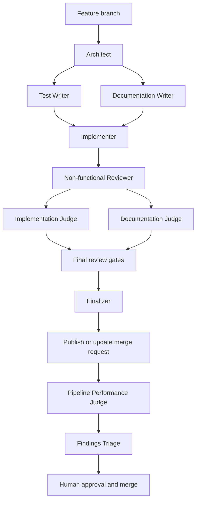

# Why the agent workflow uses specialized roles

This page explains how the generated multi-agent workflow turns a change into
a human-reviewed merge request without leaving role selection to a frontend's
interpretation. It is an explanation of the routing model; the authoritative
step-by-step manifest is `AGENTS.md`.

The workflow separates design, test design, documentation, implementation, and
review so every step has a clear purpose and an independent check. Roles are
portable across Claude Code, Codex, and Pi because the shared entry points are
the directories under `.agents/skills/`, not frontend-specific agents or
configuration. A display name such as “Test Writer” helps a reader understand
the phase, but it is never a routing identifier. The exact `$skill-id` named
by the manifest is the only identifier an agent may load or delegate.

`AGENTS.md` is intentionally a concise routing manifest rather than a second
copy of every role procedure. It says which file or skill to read, when it
applies, who owns the work, which capability tier to use, what evidence the
phase produces, and where a rejection goes. The selected skill then links to
the detailed role reference. This division keeps the portable decision visible
at session start while keeping role procedures in one maintained location.

## Loading is a decision, not an import side effect

Every session reads `AGENTS.md` and `.agents/project.md` before repository
work. The contribution-policy marker check is also mandatory; a failed check
loads `$repository-setup` before any other repository action. These are the
small shared context needed to understand the repository and its guardrails.

Language and process guidance are conditional. Python guidance applies when
the intended change includes Python, Bash guidance when it includes Bash,
Markdown guidance when it includes Markdown, and Python-testing guidance when
the work writes or reviews the relevant Python tests. TDD guidance applies to
non-trivial work. The manifest defines the classification boundary so an agent
does not load a full change workflow for a small, isolated correction or skip
it for a behavior-changing change.

The routing is written as imperative reads, not `@...` includes. Such includes
are not a portable recursive-loading mechanism across the supported frontends:
some hosts ignore them, while others can load an unrelated language guide on
every session. Conditional paths in the manifest make both the required and
unrequired context explicit.

Pi receives the repository's `.agents/skills` directory explicitly when the
serial worker starts it. This prevents project-trust discovery from silently
dropping the shared workflow. Claude Code uses the checked-in compatibility
link, and Codex discovers the shared skill tree, but each still follows the
same manifest and exact IDs.

The workflow is deliberately human-gated. Agents can prepare and publish a
merge request, but they do not approve or merge it. The serial GitLab loop
keeps the same boundary when it processes an issue.

For non-trivial work, the manifest names every phase rather than rolling them
up as “final judges.” It records each phase's applicability, owner, requested
tier, prerequisite, receipt, and reroute. Delegated phases use the exact tier
and Codex model/effort named by their row. In Codex those tiers resolve to
`gpt-5.6-sol` / `high` for most-capable work, `gpt-5.6-terra` / `medium` for
balanced work, and `gpt-5.6-luna` / `low` for focused checks. Other supported
frontends resolve only their enabled equivalent; Frontier is never a fallback.

Red and Green are deliberately main-agent phases: the same agent carries the
failed behavior evidence into the minimum implementation that satisfies it.
They retain the current enabled main-session model and cannot switch
model/effort mid-session. Their Balanced metadata is therefore a recommendation
for selecting that session at its start, not a runtime model switch.
The Documentation Writer is delegated in parallel with Red because it has a
separate output and must not change tests or code. Architecture, reviews, and
judges have similarly explicit delegated or main ownership in the manifest.
If a phase rejects the work, its receipt identifies the owning earlier phase
to revisit instead of allowing a later role to silently repair or waive it.

The CLI and filesystem judges are conditional only because their subjects can
be absent. Skipping either requires an explicit receipt in the applicability
record, for example `$cli-syntax-judge: not applicable — no CLI surface or
contract changed` or `$filesystem-structure-judge: not applicable — no
Python/Bash layout or packaging changed`; silence is not a skip. The Finalizer
validates every required completion and every permitted not-applicable receipt
before it allows publication. This preserves a complete record without running
a judge against a change that cannot affect its contract or layout.

The Pipeline Performance Judge is deliberately post-publication: it examines
the current merge request's pipeline only after GitLab has produced job timing
and status evidence. It verifies the branch tip, separates runner queue time
from bootstrap, execution, cache, and artifact work, and inspects traces only
as needed for a failed or unexplained slow job. It does not busy-poll a running
pipeline, edit CI, retry work, approve, or merge. A later bounded
reconciliation supplies `needs verification` when the pipeline is not yet
terminal.

Findings Triage runs last, after the Finalizer, publication, and terminal
pipeline review. It receives accumulated Minor records from every judge,
deduplicates them with a stable marker, and creates the corresponding GitLab
Bug issues. Those issues are normal eligible input for the serial agent loop;
the triage role never edits the current change or invokes the loop itself.

For a finding against an open merge request, the issue's marker records the
verified MR IID and source tip. The later remediation worker re-verifies the
open same-project MR, resumes its source branch, and updates that MR rather
than opening another one. This makes an issue a durable follow-up record while
preserving one review thread and its human approval boundary.

## Merge requests are the shared record

A local branch and an agent session are working contexts, not the durable
record of a change. The GitLab merge request is the shared source of truth: it
records the proposed diff, branch tip, pipeline results, review discussions,
approvals, conflicts, and whether the change is open, merged, or closed.

Agents therefore interact with the merge request throughout the handoff. They
open or update it after publishing a feature branch, use its reported state to
decide whether follow-up work belongs on that branch, and return it to human
review after a repair. A new session does not infer completion from a local
checkout or a prior conversation; it checks the merge request. This keeps
review and publication visible to every collaborator and preserves the human
approval and merge boundary.

## Roles

| Role | Responsibility | Does not |
| --- | --- | --- |
| Architect | Designs modules, data structures, and dependency boundaries | Write code or tests |
| Remediator | Establishes an evidence-backed standards baseline and sequences fixes | Edit files, weaken standards, or declare skipped gates passing |
| Test Writer | Writes failing tests and stops at Red | Touch implementation |
| Documentation Writer | Creates or updates Diátaxis documentation | Touch code, tests, or README.md |
| Implementer | Makes the minimum change to reach Green | Refactor or add untested features |
| Non-functional Reviewer | Reviews test timing and performance evidence before final validation | Rerun tests, edit code, or wait for finalization |
| Implementation Judge | Runs applicable Python/Bash lint and non-test checks | Fix issues |
| Documentation Judge | Validates documentation accuracy and Diátaxis fit | Edit docs, code, tests, or README.md |
| Quality Judge | Reviews production-code design, clarity, and conventions | Run tooling |
| Test Judge | Reviews test quality and language-appropriate test practices | Run tooling or review production-code quality |
| README Reviewer | Ensures the README orients new visitors | Touch docs, code, tests, or agent definitions |
| CI/CD Judge | Checks CI configuration and pipeline health | Edit CI configuration or retry pipelines |
| Pipeline Performance Judge | After publication, diagnoses the current MR pipeline's health, queue, timing, image, cache, and bootstrap evidence | Edit code or CI, retry/cancel jobs, approve, or merge |
| Findings Triage | After terminal pipeline review, creates deduplicated GitLab Bug issues for actionable Minor findings from every judge | Edit code, run validation, commit, push, approve, or merge |
| CLI Judge | Checks CLI changes against safety, output, and exit-code contracts | Run tooling or edit files |
| Filesystem Judge | Checks the project layout or documented exceptions | Edit files, run tooling, or review non-layout quality |
| Finalizer | Verifies final gates and returns the final validation receipt | Fix issues or publish changes |

The role boundaries prevent one step from silently marking its own work as
complete. They are workflow controls, not a same-user security boundary; GitLab
branch protection and human review remain the final controls.

## The serial worker has narrower authority

The serial `agent-work` worker uses the same manifest and explicit skill
directory, but it is not a normal repository author. It only edits and
validates its already-prepared branch. The trusted runner, rather than the
worker, commits, pushes, creates or updates the merge request, and hands it to
human review. Neither participant approves or merges. Keeping publication in
the trusted runner lets the worker execute the technical route without gaining
authority to cross the human review boundary.

For the serial worker's exact lifecycle and command contract, see the
[serial GitLab agent-loop reference](../reference/serial-gitlab-agent-loop.md).
