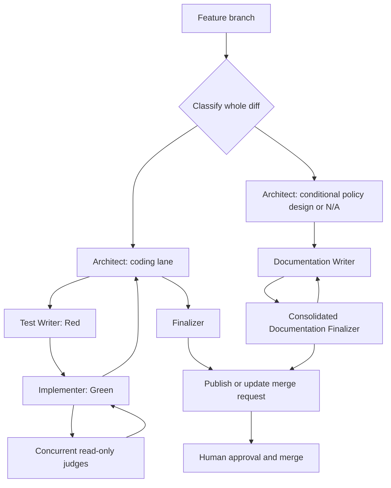

<!-- SPDX-FileCopyrightText: Copyright (c) 2026 NVIDIA CORPORATION & AFFILIATES. All rights reserved. -->
<!-- SPDX-License-Identifier: LicenseRef-NvidiaProprietary -->
<!--  -->
<!-- NVIDIA CORPORATION, its affiliates and licensors retain all intellectual -->
<!-- property and proprietary rights in and to this material, related -->
<!-- documentation and any modifications thereto. Any use, reproduction, -->
<!-- disclosure or distribution of this material and related documentation -->
<!-- without an express license agreement from NVIDIA CORPORATION or -->
<!-- its affiliates is strictly prohibited. -->

# Why the agent workflow uses specialized roles

This page explains how the generated multi-agent workflow turns a change into
a human-reviewed merge request without leaving role selection to a frontend's
interpretation. It is an explanation of the routing model; the authoritative
step-by-step manifest is `AGENTS.md`.

The workflow separates design, test design, documentation, implementation, and
review so every step has a clear purpose and an independent check. It has two
lanes: the coding lane for behavior or machine-readable-contract changes, and
the documentation and agent-policy lane for content-only changes. Roles are
portable across Claude Code, Codex, and Pi because the shared entry points are
the directories under `.agents/skills/`, not frontend-specific agents or
configuration. A display name such as “Test Writer” helps a reader understand
the phase, but it is never a routing identifier. The exact `$skill-id` named
by the manifest is the only identifier an agent may load or delegate.

Capacity is a workflow precondition, not a repository setting. The active
frontend reports available live-agent capacity through trusted runtime or
session metadata, and the manifest compares that total with the lane's widest
parallel phase. For the setup procedure and the required `needs_human`
reporting, see [Configure agent capacity](../how-to/configure-agent-capacity.md).

`AGENTS.md` is intentionally a concise routing manifest rather than a second
copy of every role procedure. It says which file or skill to read, when it
applies, who owns the work, which capability tier to use, what evidence the
phase produces, and where a rejection goes. The selected skill then links to
the detailed role reference. This division keeps the portable decision visible
at session start while keeping role procedures in one maintained location.

## Two lanes keep validation proportional

The coding lane is the default for a whole diff that changes executable code,
tests, CI, packaging, configuration, schemas, command contracts, or executable
automation. It uses the full TDD route: architecture, Red, Green, timing
review, validation, and the applicable implementation, test, CI, CLI, and
filesystem reviews. Green owns any coding-lane documentation after Red, so the
same sole mutator keeps behavior, tests, and documentation synchronized.

The documentation and agent-policy lane is for a whole diff limited to
documentation and the instructions that govern agent work. It does not invent
passing tests for prose. Instead, its writer identifies the source of truth,
records the files and mirrors changed, and validates structure: Markdown,
links and anchors, Diátaxis metadata and indexes, skill and manifest
references, and Copier rendering where a template is affected. Reviewers also
compare claims about supported versions, test commands, CI, and shell behavior
to their actual configuration and source. This checks that documentation stays
in sync without making a test suite assert wording.

The route is selected from the complete proposed diff, not from a file chosen
to describe it. A mixed diff, executable Markdown fence, or uncertainty uses
the coding lane. Agent-policy changes are never treated as trivial: changing a
route, authority boundary, or validation requirement can change how later
work is performed even when the edit is small.

Both lanes preserve the same publication boundary. They establish a feature
branch through Git flow, retain receipts for required or explicitly
not-applicable phases, publish a merge request, and leave approval and merge
to a human. The documentation lane substitutes content and policy validation
for Red, Green, JUnit timing, and code-focused judges; it does not skip the
merge-request record or human review.

## Loading is a decision, not an import side effect

Every session reads `AGENTS.md` and `.agents/project.md` before repository
work. The contribution-policy marker check is also mandatory; a failed check
loads `$repository-setup` before any other repository action. These are the
small shared context needed to understand the repository and its guardrails.

Language and process guidance are conditional. Python guidance applies when
the intended change includes Python, Bash guidance when it includes Bash,
Markdown guidance when it includes Markdown, and Python-testing guidance when
the work writes or reviews the relevant Python tests. TDD guidance applies to
the coding workflow, while content guidance applies to documentation and
agent-policy work. The manifest defines the classification boundary so an agent
does not load a full change workflow for a small, isolated correction or skip
it for a behavior-changing change.

The routing is written as imperative reads, not `@...` includes. Such includes
are not a portable recursive-loading mechanism across the supported frontends:
some hosts ignore them, while others can load an unrelated language guide on
every session. Conditional paths in the manifest make both the required and
unrequired context explicit.

Pi receives the repository's `.agents/skills` directory explicitly when the
serial worker starts it. This prevents project-trust discovery from silently
dropping the shared workflow. Claude Code uses the checked-in compatibility
link, and Codex discovers the shared skill tree, but each still follows the
same manifest and exact IDs.

The workflow is deliberately human-gated. Agents can prepare and publish a
merge request, but they do not approve or merge it. The serial GitLab loop
keeps the same boundary when it processes an issue.

For non-trivial coding work, the manifest names every phase rather than rolling
them up as “final judges.” Each manifest records phase applicability, ownership,
prerequisites, receipts, and reroutes. Delegated phases use the exact tier
and Codex model/effort named by their row. In Codex those tiers resolve to
`gpt-5.6-sol` / `high` for most-capable work, `gpt-5.6-terra` / `medium` for
balanced work, and `gpt-5.6-luna` / `low` for focused checks. Other supported
frontends resolve only their enabled equivalent; Frontier is never a fallback.

For coding work, the Architect owns one workflow session rather than launching
an unrelated top-level process for each phase. It hands its design directly to
Red; Red's returned failing-test evidence is handed directly to Green. Green is
the sole mutable owner: it reads the actual diff, fans out concurrent read-only
judges when their subjects apply, repairs actionable feedback, and consolidates
the results for the Architect. The Architect decides whether the complete
workflow is ready for finalization. This keeps the context that matters with
the agents that need it while judges use the diff and focused evidence instead
of a full workflow transcript.

For coding work, Green makes required README and documentation edits before
the read-only review fan-out; no second agent mutates the shared worktree. In
the documentation and agent-policy lane, Architect delegates one Documentation
Writer as the sole mutator, followed by one consolidated Documentation
Finalizer. The writer may repair that complete finding set once. A repeated
rejection or scope expansion returns to Architect for human direction.

The CLI and filesystem judges are conditional only because their subjects can
be absent. Skipping either requires an explicit receipt in the applicability
record, for example `$cli-syntax-judge: not applicable — no CLI surface or
contract changed` or `$filesystem-structure-judge: not applicable — no
Python/Bash layout or packaging changed`; silence is not a skip. The Finalizer
validates every required completion and every permitted not-applicable receipt
before it allows publication. This preserves a complete record without running
a judge against a change that cannot affect its contract or layout.

## Publication returns promptly to the human boundary

Publication ends the workflow session and returns the verified merge request
to human review. The trusted serial runner may observe the exact pipeline as a
bounded recovery concern, but it does not start another general-purpose agent
phase for new work. Pipeline failure or conflict re-enters the coarse workflow
with the preserved worktree and evidence. Agents never approve or merge, and
they never change project-owned values or workflow policy merely to clear a
gate without explicit human approval for that exact change.

## Merge requests are the shared record

A local branch and an agent session are working contexts, not the durable
record of a change. The GitLab merge request is the shared source of truth: it
records the proposed diff, branch tip, pipeline results, review discussions,
approvals, conflicts, and whether the change is open, merged, or closed.

Agents therefore interact with the merge request throughout the handoff. They
open or update it after publishing a feature branch, use its reported state to
decide whether follow-up work belongs on that branch, and return it to human
review after a repair. A new session does not infer completion from a local
checkout or a prior conversation; it checks the merge request. This keeps
review and publication visible to every collaborator and preserves the human
approval and merge boundary.

## Roles

| Role | Responsibility | Does not |
| --- | --- | --- |
| Architect | Owns the coding workflow session, design, context handoff, and final decision | Write production changes or tests |
| Remediator | Establishes an evidence-backed standards baseline and sequences fixes | Edit files, weaken standards, or declare skipped gates passing |
| Test Writer | Writes failing tests and stops at Red | Touch implementation |
| Documentation Writer | Main-owned editor for documentation and agent-policy changes | Change executable scope or manufacture behavior tests |
| Implementer | Green's sole mutable owner; implements code and documentation, reads the diff, and consolidates judge feedback | Waive failed review evidence |
| Non-functional Reviewer | Reviews test timing and performance evidence before final validation | Rerun tests, edit code, or wait for finalization |
| Implementation Judge | Runs applicable Python/Bash lint and non-test checks | Fix issues |
| Diátaxis Judge | Validates documentation accuracy and Diátaxis fit | Edit docs, code, tests, or README.md |
| Agent Policy Judge | Reviews agent routing, portable skills, mirrors, and authority boundaries | Edit instructions, code, tests, or README.md |
| Quality Judge | Reviews production-code design, clarity, and conventions | Run tooling |
| Test Judge | Reviews test quality and language-appropriate test practices | Run tooling or review production-code quality |
| README Reviewer | Ensures the README orients new visitors | Touch docs, code, tests, or agent definitions |
| CI/CD Judge | Checks local CI configuration alignment and static job shape | Inspect live GitLab CI or edit configuration |
| CLI Judge | Checks CLI changes against safety, output, and exit-code contracts | Run tooling or edit files |
| Filesystem Judge | Checks the project layout or documented exceptions | Edit files, run tooling, or review non-layout quality |
| Finalizer | Verifies final gates and returns the final validation receipt | Fix issues or publish changes |
| Documentation Finalizer | Verifies content classification, structure, mirrors, and source synchronization | Edit, stage, publish, or call remote APIs |

The role boundaries prevent one step from silently marking its own work as
complete. They are workflow controls, not a same-user security boundary; GitLab
branch protection and human review remain the final controls.

## The serial worker has narrower authority

The serial `agent-work` worker uses the same manifest and explicit skill
directory, but it is not a normal repository author. It only edits and
validates its already-prepared branch. The trusted runner, rather than the
worker, commits, pushes, creates or updates the merge request, and hands it to
human review. Neither participant approves or merges. Keeping publication in
the trusted runner lets the worker execute the technical route without gaining
authority to cross the human review boundary.

For the serial worker's exact lifecycle and command contract, see the
[serial GitLab agent-loop reference](../reference/serial-gitlab-agent-loop.md).
