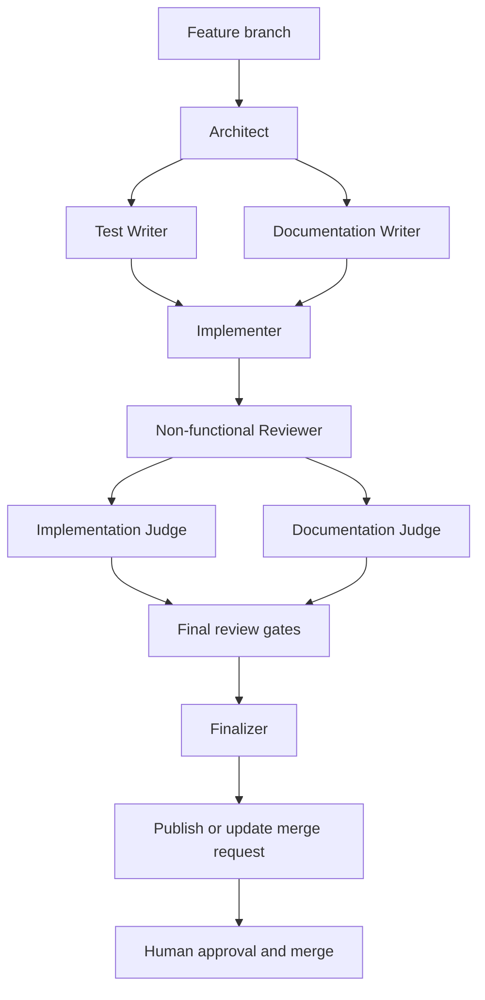

# Why the agent workflow uses specialized roles

**Diátaxis category: Explanation.** This page explains how the generated
multi-agent workflow turns a change into a human-reviewed merge request.

The workflow separates design, test design, documentation, implementation,
and review so that each step has a clear purpose and an independent check. It
is portable across Claude Code, Codex, and Pi: every role is defined by a
shared Agent Skill, while each frontend resolves the requested capability tier
through its own configuration.

The workflow is deliberately human-gated. Agents can prepare and publish a
merge request, but they do not approve or merge it. The serial GitLab loop
keeps the same boundary when it processes an issue.

For non-trivial work, the Test Writer and Documentation Writer proceed in
parallel after design. The Implementer makes the smallest change that satisfies
the failing tests. Validation and final review then provide separate evidence
for implementation, documentation, tests, quality, CI, the README, CLI
behavior, and filesystem structure. Small, low-risk changes can use the same
publication and validation boundaries without the full routing sequence.

## Merge requests are the shared record

A local branch and an agent session are working contexts, not the durable
record of a change. The GitLab merge request is the shared source of truth: it
records the proposed diff, branch tip, pipeline results, review discussions,
approvals, conflicts, and whether the change is open, merged, or closed.

Agents therefore interact with the merge request throughout the handoff. They
open or update it after publishing a feature branch, use its reported state to
decide whether follow-up work belongs on that branch, and return it to human
review after a repair. A new session does not infer completion from a local
checkout or a prior conversation; it checks the merge request. This keeps
review and publication visible to every collaborator and preserves the human
approval and merge boundary.

## Roles

| Role | Responsibility | Does not |
| --- | --- | --- |
| Architect | Designs modules, data structures, and dependency boundaries | Write code or tests |
| Remediator | Establishes an evidence-backed standards baseline and sequences fixes | Edit files, weaken standards, or declare skipped gates passing |
| Test Writer | Writes failing tests and stops at Red | Touch implementation |
| Documentation Writer | Creates or updates Diátaxis documentation | Touch code, tests, or README.md |
| Implementer | Makes the minimum change to reach Green | Refactor or add untested features |
| Non-functional Reviewer | Reviews test timing and performance evidence before final validation | Rerun tests, edit code, or wait for finalization |
| Implementation Judge | Runs applicable Python/Bash lint and non-test checks | Fix issues |
| Documentation Judge | Validates documentation accuracy and Diátaxis fit | Edit docs, code, tests, or README.md |
| Quality Judge | Reviews production-code design, clarity, and conventions | Run tooling |
| Test Judge | Reviews test quality and language-appropriate test practices | Run tooling or review production-code quality |
| README Reviewer | Ensures the README orients new visitors | Touch docs, code, tests, or agent definitions |
| CI/CD Judge | Checks CI configuration and pipeline health | Edit CI configuration or retry pipelines |
| CLI Judge | Checks CLI changes against safety, output, and exit-code contracts | Run tooling or edit files |
| Filesystem Judge | Checks the project layout or documented exceptions | Edit files, run tooling, or review non-layout quality |
| Finalizer | Verifies final gates and commits locally before publication handoff | Fix issues |

The role boundaries prevent one step from silently marking its own work as
complete. They are workflow controls, not a same-user security boundary; GitLab
branch protection and human review remain the final controls.

For the exact generated files and tooling, see the
[template contract](../reference/template-contract.md). For the workflow's
documentation model, see [why this repository uses Diátaxis](why-diataxis.md).
