# Why the Phase 1 runner is bounded

Phase 1 intentionally turns one human-selected GitLab issue into one agent
run. It is a bridge between the existing repository workflow and later queue
or service designs, not a background worker.

```mermaid
flowchart LR
    human[Human selects an issue] --> command[run-issue]
    command --> lock[Common-Git lock and private state]
    lock --> preflight[Refresh and verify repository state]
    preflight --> claim[Claim the ready issue]
    claim --> workspace[Independent project-scoped working copy]
    workspace --> codex[One Codex workspace-write invocation]
    codex --> verify[Validate v1 result and GitLab artifacts]
    verify --> handoff[awaiting_human]
    handoff --> review[Human review, approval, and merge]
```

The boundary keeps authority legible. The human selects the issue and must add
`--apply`; the runner then performs only the work needed to publish a branch
and merge request. It stops at `awaiting_human`. Approval and merge remain
human actions, so successful automation never implies permission to land code.

GitLab issue text is useful but hostile by default. It can say what work is
desired, while repository instructions and the runner retain control of which
repository, credentials, sandbox, and approval policy apply. The runner checks
the configured numeric GitLab project rather than accepting an issue-provided
project, branch, or merge-request URL as authority.

The single local lock and deterministic `agent/issue-<iid>` working copy make
the one-run boundary recoverable and inspectable. Each copy is an independent
clone from the configured project's verified HTTP URL, with its own private
`.git` directory; it is not a linked worktree and does not share the source
checkout's common Git directory or references. Codex receives workspace-write
access only to this copy, not the source common-Git directory or the runner's
private journal, provenance, canonical-result, or recovery evidence. Retaining
the copy after handoff preserves the reviewed state; Phase 1 deliberately does
not decide cleanup policy.

Runner-authored provenance binds a retained copy to the configured project,
origin, exact issue branch, and a digest of the normalized issue title, body,
and sorted non-lifecycle labels. Reuse is therefore not merely path-based.
Before accepting a published continuation, the runner requires one exact
commit SHA across the retained clone, remote branch, and same-project open
merge request. A new copy starts its exact issue branch at refreshed
`origin/<default-branch>`, avoiding an implicit dependency on the source
checkout's local branch state.

The lock encloses a deliberately mutating preflight. Private lock and journal
state live under the common Git directory; the runner refreshes the configured
default branch's remote-tracking ref, runs local tests, and compares local,
remote, workspace, and merge-request state. These effects are safe preparation,
not a claim: the issue is not relabelled and no workspace or Codex process starts
until every preflight check and the locked issue reread succeed.

At the other end, `awaiting_human` is intentionally narrower than the shared
schema alone. The schema can describe an artifact-free human blocker for other
consumers, but this publish command accepts only a handoff whose branch, exact
tip, retained copy, and open same-project merge request have all been verified.
It durably creates that canonical result before recording the handoff, and
never overwrites it. If a later best-effort issue-label or note projection
fails, separate recovery evidence records that fact while the verified
`awaiting_human` result remains canonical. Anything less follows the recorded
failure projection instead of being reported as success.

Later phases may add intake adapters, distributed claims and leases, retry
backoff, reconciliation, filesystem delivery, or supervisors. They require
their own durability and authorization decisions. A timeout on this command
only limits one invocation—it is not a polling loop or daemon. For the
operational contract, use the [Phase 1 runner reference](../reference/phase-1-run-issue.md).
