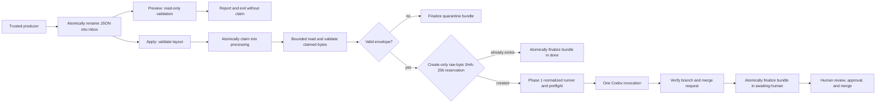

# Why the Phase 2 filesystem intake is bounded

*Diátaxis category: Explanation.*

Phase 2 turns one producer-delivered JSON file into at most one published
merge-request handoff. It adds a local, atomic handoff boundary to the Phase 1
runner; it does not turn the coding agent into a long-running inbox service.

The inbox name alone is not trust. The runner accepts a configured absolute
layout, rejects path tricks and unsafe filesystem objects, and maps only an
allowlisted repository alias to a repository. JSON fields describe work but do
not confer authority over repository selection, credentials, sandbox settings,
or review policy.

Atomic moves make ownership visible without a database or background worker.
`inbox/` means ready for a bounded attempt; `processing/` means claimed;
`done/`, `awaiting-human/`, and `failed/` hold finalized bundles;
`quarantine/` holds a validly addressed but invalid payload and its intake
result. The runner first claims an invalid payload into `processing/`, durably
creates and fsyncs a complete quarantine staging bundle from those claimed
bytes, atomically renames the staging directory into `quarantine/`, and then
durably removes the processing claim. Duplicate no-ops use
`done/<full-sha256>-<run-id>/`, so the no-op is observable without invoking
Codex. Requiring non-overlap and one filesystem device ensures that the moves
used for these state changes are atomic rather than copy-and-delete
approximations.

Using the exact raw bytes for SHA-256 deduplication matters because it makes
the identity independent of parser behavior or normalized field ordering. A
create-only reservation is made only after a valid envelope is atomically
claimed into `processing/`, and before its workflow begins. A later valid
delivery of the same content finds that reservation and is safely finalized as
an exit-0 `done/` no-op without a second Codex invocation or publication.
Invalid payloads are quarantined on each applied delivery: they never reserve
or deduplicate a hash.

A reservation is evidence of a claim, not proof of a completed handoff. A
crash or finalization failure can leave both the reservation and
`processing/` evidence behind. Phase 2 deliberately stops in that state rather
than guessing whether to rerun or discard the request; a human or the Phase 3
reconciliation capability must resolve it.

The command remains intentionally narrow. Preview is entirely read-only, and
application requires `--apply`; then the runner delegates the repository work
to the already bounded Phase 1 normalization, preflight, invocation, and
publication verification. A verified result stops at `awaiting_human`. Human
review, approval, and merge remain required.

Watchers, producer authentication, leases, retry/backoff, reconciliation,
concurrency, and any authorization for unattended publication require separate
operational and security decisions in later phases. For commands and exact
constraints, see the [Phase 2 `run-file` reference](../reference/phase-2-run-file.md).
