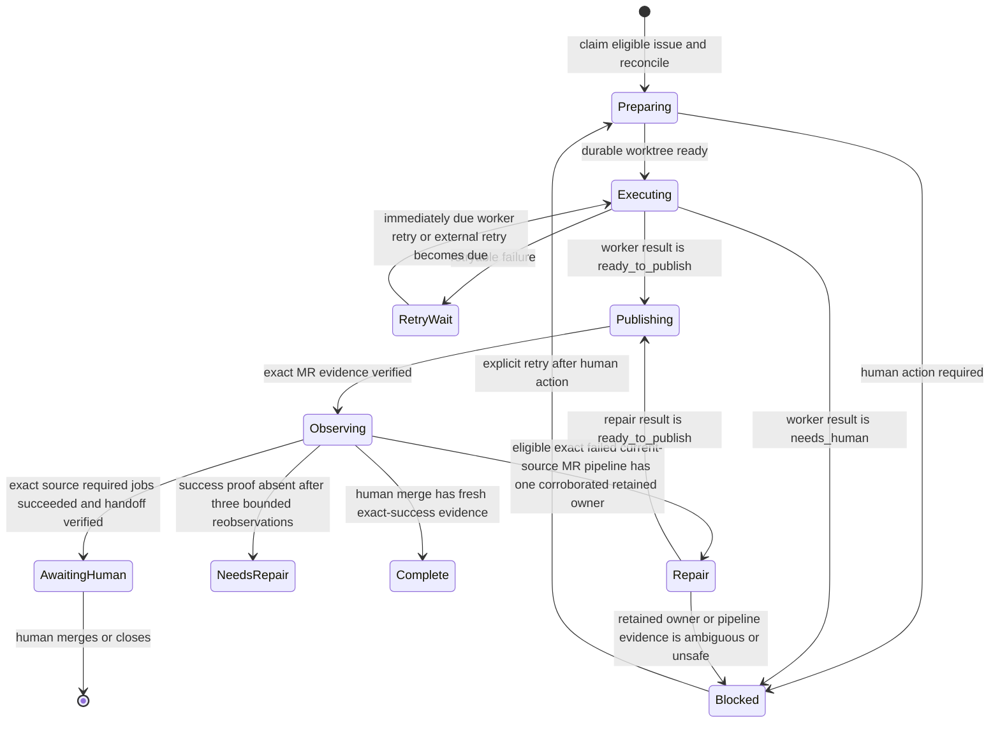

<!-- SPDX-FileCopyrightText: Copyright (c) 2026 NVIDIA CORPORATION & AFFILIATES. All rights reserved. -->
<!-- SPDX-License-Identifier: LicenseRef-NvidiaProprietary -->
<!--  -->
<!-- NVIDIA CORPORATION, its affiliates and licensors retain all intellectual -->
<!-- property and proprietary rights in and to this material, related -->
<!-- documentation and any modifications thereto. Any use, reproduction, -->
<!-- disclosure or distribution of this material and related documentation -->
<!-- without an express license agreement from NVIDIA CORPORATION or -->
<!-- its affiliates is strictly prohibited. -->

# Recoverable serial agent-loop architecture

One run owns one bounded issue flow. After a handoff, the systemd wrapper checks
its report and refreshes project and default-branch proof. It polls a live
pipeline in place. Only idle or saved handoffs return control to the timer.

This page explains recovery design. The [serial GitLab agent-loop
explanation](serial-gitlab-agent-loop.md) explains use. The
[reference](../reference/serial-gitlab-agent-loop.md) owns commands, schemas,
states, and exit codes. The setup guide owns user steps.

The scheduler was healthy, but missed recovery, repair, and post-publish work.
The new state machine keeps worktrees and one coarse `WORKFLOW` boundary. It
stores no checkpoints for individual agent roles or workflow stages.

## Evidence and confirmed defects

The 2026-09-09 audit found an enabled, healthy timer. Its last run had no ready
work. GitLab had 12 past `agent/issue-*` MRs: 10 merged and two closed. The
journal had 886 idle and nine failed-work results. Issues 13–16 had terminal
`agent::failed` labels. All 68 runner tests passed, but describe code that can
differ from the end-to-end contract.

The audit confirmed these defects:

1. Selection has no saved queue rule for open, non-confidential issues.
2. Existing-MR repair is absent. MR !88 starts a new `agent/issue-*` branch
   from `main`; files are missing.
3. Expected blocks look like publish faults: an open-MR need, wrong repair
   branch, protected policy work, or no-op all say “worker made no changes to publish.”
4. Cleanup saves stops as recovery stashes, but no runner restores them. An
   issue-12 stash has ten changed files.
5. One short worker must do design, Red/Green, docs, reviews, finalization,
   and post-publish work. Trusted publish waits for it to end.
6. Python and Bash both restore checkouts. `logger -s` duplicates lines that
   systemd already captures.
7. Status lacks phase, stable error code, retry state, and next action. The
   journal has detail; GitLab has a vague failure note.
8. Preview refreshes a checkout though it must not change state. Failed
   default-branch repair enters other issue work; stale branches can fail
   issues; closed issues keep terminal labels; timer gaps start at run, not end.

These facts led to this design. Old issues, branches, labels, stashes, and
services stay as proof until a user reviews a migration preview.

## State model

GitLab is the shared queue. A small local ledger holds run detail not in labels.

GitLab labels stay broad:

- `agent::running`: active or self-resuming work.
- `agent::awaiting-human`: exact MR, named source commit, and factory-authored
  actionable issue handoff await human review.
- `agent::blocked`: documented human action is needed.
- `agent::failed`: a rare, fatal state prevented safe checking or recording.
- `agent::needs_repair`: legacy or reviewed repair, exhausted required-job
  proof after a successful exact-source pipeline, or a canceled exact-source
  pipeline for a retained observing owner awaits exact recovery. An ordinary
  failed pipeline uses its diagnostic repair path.
- `agent::repair_failed`: auto or reviewed repair failed, or exact proof
  changed. It keeps follow-up proof.
- `agent::suggest_close`: confirmed proof asks a human to close duplicate,
  superseded, satisfied, or unfit work.

The three repair and close labels exclude each other and running,
awaiting-human, blocked, and failed. None is selectable. The ledger is the
log. It splits `agent::running` into `preparing`, `executing`, `retry-wait`,
`publishing`, `observing`, and `repair`. `agent::repair_failed` keeps plan ID,
proof delta, fault, time, and worktree. `agent::blocked` covers authority,
safety, and open proof; `agent::failed` is rare and fatal. Labels show owner.

Split prior-need labels are a user view. On an open child,
`agent-prereq_<IID>` names one open, trusted need. The labels are non-scoped, so
one issue can show many needs. Gates use checked markers and live issue state.

Each proof starts with direct prerequisites. An open prerequisite stays a need.
A closed split parent expands to every required open child. If a closed child
was also split, the proof repeats this step. This keeps dependent work blocked
while replacement work is open.

During an interrupted controller split, the parent stays open. It remains the
direct need. The proof expands only a closed parent and only to observed
children with valid markers.

Label projection, fresh selection, and retained recovery use the same proof
from one complete issue snapshot. Labels show every open proof member. The
runner fails closed for a duplicate issue IID or an invalid issue state. It
also stops for a missing literal dependency or a duplicate `(parent,key)` child
identity. A malformed or ambiguous marker, self-reference, or cycle also stops
it. An absent marker parent remains valid provenance. On failure, the loop
claims no dependent worker and starts no tight retry.

A retained dependent stays `dependency_gated` while any proof member is open.
When all members close, its saved work can become `safely_retryable`. It still
follows normal human merge-request review.

The runner sorts the displayed IIDs and creates or reuses fixed labels. It
removes a label when the complete proof has no matching open need. It also
removes labels when the dependent closes or a trusted marker ends the
dependency. Migration keeps legacy `agent::prereq_<IID>` definitions until each
changed issue has its full set. A stopped move retries. A failed remote update
leaves retryable view drift. These labels never change child authority, life
cycle, or fit.

Auto exact-pipeline repair is item-bound. One failed try saves a 20-minute
backoff. Three failed auto tries quarantine or defer it for human review.
Status and preview show both. Later runs still scan for ready repair or work.

This differs from ordinary `RETRY_WAIT` and global fail-closed conflicts.
Inexact ID, active ownership, credentials, policy, and authority still stop
selection. Reviewed recovery is a rare exact-IID action. It does not use the
auto repair budget.

Split handling is not saved recovery. After a protocol-v2 `split_required`
result, the loop makes or reuses marker-bound children while running.
It then notes and closes the parent. A retry starts fresh and repeats marker
searches. It restores no plan, progress record, transactional prefix, or
checkpoint. Split children need no supervisor projection.

## Scheduler liveness and item-local recovery

The scheduler can take another ready item while one waits. Backoff, quarantine,
need, retry, and handoff are saved and local. A run stops for ID or credential
failure, the project lock, bad shared state, or unclear cross-item ID. It then
cannot name the project or its sole item safely.

The loop moves one owner. It starts at most one auto repair per run. It logs a
deferred item's next safe action, then scans in fixed order.

The scheduler treats each saved state as follows:

- `PREPARING`: a clean worktree matches. Resume or repair.
- `EXECUTING`: saved worktree proof exists. Resume or repair at `WORKFLOW`.
- `RETRY_WAIT`: no live owner and `retry_at` is due. Resume first due item;
  defer a later one and keep scanning.
- `PUBLISHING`: exact branch and worktree wait to publish. Resume or repair.
- `OBSERVING`: the exact MR SHA has a live pipeline. Wait or resume. A safe
  owned terminal fault can enter repair.
- `REPAIR`: exact failed current-source proof and one owner permit repair.
- `NEEDS_REPAIR`: old or reviewed proof, or exhausted required-job proof after
  a successful exact-source pipeline, defers new work. Show exact-IID reviewed
  recovery and keep scanning.
- `REPAIR_FAILED`: resume only when due and safe. Else defer or quarantine,
  then keep scanning.
- `SUGGEST_CLOSE`: proved duplicate, replacement, or poor fit skips work and
  shows the close choice.
- `BLOCKED`: human action or open proof skips work. Show that action.
- `AWAITING_HUMAN`: a checked handoff for an exact MR SHA skips work and stays.
- `FAILED`: a rare item fault skips work. Show recovery action.
- `COMPLETE`: a closed issue or complete record needs no action.

Progress is bounded and clear. Its fingerprint has issue ID, state, phase,
exact branch, MR, pipeline ID, and action. A changed fingerprint or closed end
is progress. Unchanged proof is not. Defer, quarantine, or hand off. Status
and preview show cause, time, tries, proof, and next action. Preview uses the
same choices. It claims no work and changes no GitLab, ledger, worktree, branch,
or service.

Trusted constants set budgets, waits, ranks, and locks. Issue and MR text
cannot set them or turn a local delay into project authority.

## State-machine activation and workflow sessions

Each activation holds at most one local activation lock: the single-project
lock. The lock is local. It reconciles durable evidence and advances at most
one issue in a workflow-owning session. Recovery covers that session, not
internal agent handoffs.

| Phase | Action | Required evidence or authority | Stop or next state |
| --- | --- | --- | --- |
| Lock and reconcile | Acquire the local lock. Reconcile GitLab issues, MRs, worktree, branches, and ledger. | The single-project lock and durable evidence. | Continue to pipeline checks. |
| Pipeline gate | Check each newest default-branch and open-MR pipeline. Require its exact current source SHA. | Exact current-source pipeline evidence. | Missing, malformed, or inaccessible evidence blocks. Nonterminal evidence yields. An exact failed MR pipeline enters `repair` only with one uniquely corroborated retained owner. |
| Retained-work recovery | Resume one durable immediate `agent::running` record. Reclassify one blocked IID only with that issue's passive owner-marker corroboration and reviewed `loop recover --issue-iid IID`. | Status and inventory report each retained issue independently. A reviewed exact-IID plan can reconcile a stale or missing target, but another live owner occupies the one-item capacity. Ordinary admission remains fail-closed when more than one immediate record exists. | It never handles a uniquely owned failed current-source MR pipeline. |
| Human block | A failed or canceled default-branch pipeline blocks unrelated work. An ownerless failed or canceled open-MR pipeline stays item-local. | Earlier gates and targeted recovery must allow selection. | Continue only when that authority exists. |
| Prerequisite projection | Derive and reconcile prerequisite-label projections from one complete marker and live-state proof before selection. | A changed projection. | End as housekeeping. Claim no work. Create no record, worktree, or worker session. |
| Eligibility and ranking | Select open, non-confidential issues only. They need no lifecycle projection, ledger record, open split prerequisite, or required open descendant of a closed decomposition parent. Rank exact high, normal with no recognized exact priority, then exact low. | Absolute creation time and IID break rank ties. | Continue to classification. |
| Classification | Classify before claim: ordinary work, existing-MR remediation, merge-conflict repair, or manual-lane protected policy work. | The applicable classification and Architect lane. | Claim only after classification. |
| Write-ahead transition | Persist intent before each external mutation. Record its observed result. | Durable intent and observed result. | Reconciliation completes or compensates across interruption. |
| Worker | Run one bounded owner worker in its durable worktree. Validate its versioned `ready_to_publish`, `retryable`, or `needs_human` result. | The one workflow-owning worker session and its versioned result. | Continue to publication only with a valid result. |
| Publication | Publish idempotently. Verify exact same-project MR, branch, target, tip, and closing-issue evidence. Record one safe action. | Exact GitLab and Git evidence. | Continue only with safe progress. Otherwise yield for idle, no progress, future wait, terminal or human state, or workflow or wall-time bound. |

An interrupted ordinary workflow may publish before ledger MR recording. Before
retry, worker, baseline, push, or MR creation, inventory opened MRs for the
recorded source branch. Accept one only when numeric source and target projects,
branches, source SHA, closing relation, and durable worktree all match. That MR
is authoritative. Never choose the newest candidate. Mismatch or ambiguity is
`publication_identity_mismatch`. Empty inventory changes no ordinary recovery.
After verification, reconcile Draft metadata without downgrading it. Clear
retry fields atomically. Start exact-SHA observation in that activation.

The runner may accept an MR descendant SHA for ordinary retained-branch
advancement only with every corroborating fact. These are configured numeric
project identity; retained MR identity and URL, when present; matching source
branch; configured target project and default branch; clean retained worktree;
exact retained branch and `HEAD` equal to MR source SHA; ancestor proof; and
no competing identity. Missing or conflicting facts quarantine the item
locally. Scanning continues. Never choose a plausible newest MR.

Fresh selection begins its applicable workflow. It seeks human handoff or a
yield in that activation. Reconciliation restores existing worktrees. It
re-enters their coarse `WORKFLOW` state. Legacy phase-ledger values finish
their recorded route. First rollout adds no sidecar checkpoints for Architect,
Red, Green, documentation, or judges.

Default activation allows 16 workflow attempts in a 10,800-second
(three-hour) budget. Each owning invocation gets positive, ceil-rounded time
left. Exhaustion follows durable-worktree retry and recovery. Retryable worker
failures are immediately due and continue. Nonterminal default-branch or exact
current-MR evidence rechecks in place. Delays are 5, 10, then 20 seconds,
capped at 30. It resumes when evidence is terminal. The 20-minute timer starts
only after service inactivity for idle, no eligible work, or no resumable work.
It never paces an active pipeline wait.

Future retries, human or safety blocks, missing, failed, or unrecognized
evidence, activation deadline, and systemd timeout are durable handoffs. The
oneshot outer envelope is 190 minutes. It combines the approved 180-minute
worker budget and ten minutes for checkout, GitLab, publication, and reports.
It bounds hangs without shrinking 10,800-second worker budget. Housekeeping
has 120-second deadlines. Workers get remaining budget. On expiry, systemd
ends the control group after 30-second TERM-to-KILL grace. It retains
`Result=timeout` and journal evidence. This stops hangs predictably. The ledger
and worktree support retry and diagnosis. The timer owns no workflow state or
checkout cleanup.

## Durable ledger and worktrees

The XDG state directory uses GitLab host and numeric project ID as its key. Reconcile
this ledger before selecting work. Each active issue has one durable worktree
and one record. The record tells recovery what to do, in order.

| Durable field group | Purpose and constraint |
| --- | --- |
| Schema version, project identity, issue IID, and work kind | Name one known record, project, and issue. |
| State, coarse workflow phase, attempt count, retry deadline, and last transition time | Use only this state and phase. Retry by this count and deadline. |
| Base, source, and target branches with observed commit IDs | Keep branch identity and the commit IDs used to check it. |
| Verified reconciliation target commit | Keep the exact SHA used to merge the worktree with the target branch before replay. |
| Merge-request identity and verified publication evidence | Keep the MR IID, project identities, branches, exact source SHA, and publication marker. |
| Worker protocol version, latest result kind, and historical receipts | Keep them readable for legacy records. Treat receipt prose as non-authoritative. Keep controller evidence markers and the human-handoff marker. |
| Stable error code, redacted summary, and explicit next action | Keep a stable error identity and next action. Redact detail. |
| Transition intent | Write an external-change intent first, so it can be replayed safely. |

| Condition | Ledger or worktree action |
| --- | --- |
| A record is new, resumed, or stopped mid-step | Atomically write the ledger with restricted permissions. Reconcile before work resumes. |
| A record is corrupt, unsupported, missing, unknown, or ambiguous | Fail closed as `agent::blocked`. Use `agent::failed` only if safe recording or reconciliation fails. |
| A durable worktree, commit, or verified remote ref is found | Keep it with its record as normal persistence. Do not make a competing worktree. |
| A stash is found | Inventory it and associate it with its worktree as emergency evidence. Never apply, drop, or clean it up automatically. |
| Cleanup is safe | Clean only the durable worktree owned by a terminal, reconciled record. Keep its ledger and ownership evidence until then. |
| Diagnostics are stored | Redact them. Never save tokens, secrets, credentials, issue-body authority, or unredacted worker transcripts. |

## Invariants

The table maps each invariant to the required control or evidence.

| Invariant | Required control or evidence |
| --- | --- |
| Local activation | One local activation holds the project lock. |
| Resumable work | Do not claim new work while resumable running work exists. |
| Retry selection | `RETRY_WAIT` records queue; they are not concurrent owners. Ordinary unpinned selection uses durable state, resumes one immediate record, and fails closed when more than one immediate record exists. Passive owner-marker reconciliation applies to status, inventory, and reviewed exact-IID recovery. Due retries remain in deterministic deadline/IID order. Unknown owner evidence or shared branch, worktree, or MR identity fails closed in that recovery path. |
| New-issue eligibility | Project-level loop enablement permits unattended work. A new issue must be open and non-confidential. It must have no `agent::running`, `agent::awaiting-human`, `agent::blocked`, or `agent::failed` label and no ledger record. |
| Issue identity | One issue has one durable worktree and one authoritative source branch. |
| MR uniqueness | Existing-MR remediation uses the verified MR source branch. It never makes a second MR. |
| Durable transitions | A transition is replayable. Its intent is durable before an external write. Reconciliation is safe after interruption on either side of that write. |
| Exact-source observation | During exact-source pipeline observation, a human merge completes the record only after fresh evidence corroborates the configured project and recorded MR IID. It must also corroborate both MR project identities and branches, the recorded exact source SHA, the closing relationship, the closed issue, and that SHA's successful pipeline with at least one current required job and success from every current required job. Identity mismatches block. For a closed merged issue, missing or non-successful current required-job proof preserves its closed wrapper for a later recheck; it cannot complete the record. |
| Completion projection | The controller persists `COMPLETE` before clearing lifecycle labels. A restart then retries only label projection after the durable completion record exists. A `BLOCKED` or `RETRY_WAIT` wrapper keeps verified publication identity. Later closed-issue reconciliation can make the same exact completion decision. For an open issue, the controller repairs the `OBSERVING` lifecycle-label projection before observation continues. |
| Publication | Publication is idempotent. It needs exact GitLab and Git evidence. |
| Protected-policy applicability | Protected-policy applicability uses the prospective publication tree against the durable verified reconciliation target, not raw worktree status. This assigns target-branch-only policy changes to the target branch. It keeps review evidence for issue-owned changes and merge resolutions that differ from the target tree. |
| Human handoff | Before projecting `agent::awaiting-human`, the runner writes one factory-authored actionable issue handoff for the exact MR source commit. A deterministic project, issue, MR, and SHA marker, plus a verified factory author, make recovery noiseless. The same SHA reuses the note. A changed SHA needs a new handoff. The note asks a human to review the named commit and either approve and merge it if acceptable or leave actionable general or inline MR feedback. The runner never assigns a reviewer, approves, or merges. |
| Workflow ownership | The full repository workflow stays in one workflow-owning session. Red changes only `tests/` and stops at the accepted checkpoint. After any policy preparation, Green changes code and tests while the Diátaxis Writer changes `docs/` and README in parallel. After both stop editing, Green requests controller staging of their combined work through the private candidate socket. Green consolidates applicable read-only judge findings and routes prose fixes to the writer for the Architect's final decision. |
| Systemd outcomes | Expected durable outcomes do not fail the systemd unit. |
| Authority boundary | The runner never approves or merges. It never widens authority from issue text, labels, comments, or worker output. |

## Workflow protocol and specialist context

The producer sends bounded intent while the worker is live. It uses private
scratch and a private Unix socket. The controller builds the result. A rejected
request gets one correction. The broker adds current controller facts. It keeps
the accepted result in memory. After exit, the controller checks identity,
state, phase, envelope, and paths. It then makes the normal ledger transition.
That transition is the durable evidence. Discussion, receipts, audit prose,
standard output, and raw input cannot authorize it.

The workflow session returns a versioned envelope. It names the issue, expected
ledger transition, completed coarse state, result kind, redacted diagnostic,
and proposed next action. Before changing state, the trusted runner checks it
against the current record and Git evidence. A deliberate stop is not a failure.

| Stage or result | Owner and required input | Receipt, transition, or stop |
| --- | --- | --- |
| `ready_to_publish` | Coding or content finalizer; validated change or repair | May proceed. New-MR work needs a returned or ledger-retained `merge_request_draft`; existing-MR remediation uses its verified MR. |
| `retryable` | Runner; current retry evidence | Retry now, or retain a future deadline for an external transient. An explicit retry of the exact issue resets the automatic budget after a human fix. |
| `needs_human` | Runner; block and concrete action | Block publication. |
| Malformed protocol or legacy receipt condition | Runner; current coarse phase and canonical identity: error code plus bounded, stable, redacted contract-field or reason diagnostic | Retry once immediately. The same later identity blocks, retains phase, worktree, and safe cause, and creates the normal blocked projection and comment. A changed code, diagnostic, or phase uses the bounded retry path; non-protocol transients keep their retry rules. Historical receipt prose cannot authorize the retry. |
| Architecture through Green | Architect gives the approved design to Red, completes any policy preparation, then starts Green and the Diátaxis Writer after the accepted checkpoint | Green implements code and tests while the writer aligns docs and README with the final interface. After both stop editing, Green asks the controller to stage one candidate. |
| Green through finalization | Green; final interface, documentation, and applicable read-only judge receipts | Green runs judge fan-out, corrects code and tests from evidence, routes prose findings to the writer, consolidates feedback, and returns it to Architect. The Diátaxis Judge compares design, writer receipt, final docs, and final interface; its verdict and writer evidence are required finalizer evidence. |
| Publication and required-job proof | Architect, finalizer, then runner; complete finalizer evidence | `observing` and exact-MR-conflict `repair` are durable. The controller verifies current required jobs before human handoff. |

The installed pre-commit hook checks the proposed change. The runner sends the
work back for a fix only when standard pre-commit output identifies a failed
hook and the issue, branch, commit, pending merge, staged Git tree, and retained
changes still match.

The runner keeps the staged files and worktree changes. It drops the old
result, merge request draft, historical receipts, and final audit because the code must be
checked again. It returns to a fresh complete workflow for correction and
validation. A coding correction must reuse the exact retained Red checkpoint.
A content correction does not load Red evidence. Both lanes return fresh
bounded worker intent and a fresh merge request draft. The controller verifies
their current program state and changed paths. An unknown lane, or missing or
mismatched coding Red evidence, blocks the correction. The rejection route does
not push or change a merge request.

Current detection needs clear failed-hook output. It does not reinterpret other
publication failures. A reviewed retry has one narrow route for an old dirty
candidate blocked as `publication_identity_mismatch`.

Preview and apply read the same controller-owned ledger revision, lane, intent,
and baseline. They check the branch, `HEAD`, a read-only staged-index
fingerprint, staged paths, and unstaged paths. Unstaged paths must be non-empty
and stay within the controller-observed staged paths. Historical audit prose is
readable context only. Drift fails before a ledger, Git, label, or remote change.
Unknown lanes, generic Git failures, and unclear, untracked, unmerged, or
changed evidence stay blocked.

On success, apply keeps the index, worktree, history, and retry evidence. It
removes stale publication results and enters the correction workflow used for
`publication_commit_rejected`. Coding loads the exact Red checkpoint. Content
returns fresh content evidence without Red. The route does not commit, push,
or change a merge request. Normal lifecycle projection may change blocked to
running.

This route is only for a recognizable installed pre-commit rejection. Signing,
identity, configuration, lock, file-system, object-database, and unknown commit
failures keep their fail-closed handling. Missing, ambiguous, or changed
publication identity remains `publication_identity_mismatch` and fails closed.

Protected policy also needs the exact proposed tree, target, controller-observed
paths, lane, and applicable program-owned checkpoints. A safe disputed result
starts `Draft:` and explains the human decision. That prose cannot authorize
publication. Missing controller evidence, an unsafe worktree identity, expanded
authority, project-owned value changes, `needs_human`, or finalizer rejection
blocks publication. The runner never builds a publication request from issue
text. The worker never commits, pushes, or opens an MR. Only a human reviews,
approves, or merges the exact MR.

## Failure taxonomy and process exits

Classify a failure before choosing its label or exit code.

| Category | Evidence | Label or state | Outcome |
| --- | --- | --- | --- |
| Idle | No resumable record or eligible issue. | `idle` | Exit successfully. |
| Retryable | A timeout, temporary API failure, or transient runner contention. | `retry-wait` | Make at most three automatic attempts. |
| Human-blocked | An ambiguous request, unmet dependency, or unsafe policy or recovery evidence. | `agent::blocked` | Record the exact next action. |
| Awaiting review | The exact MR, source commit, pipeline, and handoff are verified. | `agent::awaiting-human` | Wait for human review. |
| Unrecoverable | The ledger cannot be read or written safely, or identity conflicts cannot be reconciled. | `agent::failed`, when safe to record | Stop safely. |

Systemd treats idle, scheduled retry, blocked, and awaiting review as successful
exits. Exit `1` means the runner cannot safely record or reconcile state.
CLI-usage errors are not runtime failures. For an interactive caller, lock
contention is temporary. The reference owns the exact CLI, JSON schema, and
full exit-code table.

## Recovery and reconciliation

Reconciliation uses ledger intent and external evidence to choose the next safe
transition.

| Condition and evidence | Recovery action or stop condition |
| --- | --- |
| A `running` issue has a valid ledger and worktree. | Resume its recorded coarse workflow state, regardless of which process created it. |
| A persisted transition intent is checked against GitLab and Git. | Record an external mutation that already completed; retry an absent idempotent one. |
| Replay needs target-branch reconciliation. | Persist the exact verified target commit. Recovery uses that commit, so interruption cannot compare the prospective publication tree with a later target tip. An unresolved conflict, or a missing, mismatched, or ambiguous merge identity, fails closed before publication. |
| An awaiting-human projection is checked against its exact MR source SHA and factory-authored issue handoff, even when its label exists. | Repair a missing handoff before projecting the label. A transient handoff-write failure keeps durable retry state and prevents a new awaiting-human label. After an interruption, reuse an already-written verified note before repairing the label. |
| A legacy ordinary `PUBLISHING` or `READY_TO_PUBLISH` record has `source_sha`, no `merge_request_draft`, and `intent=null`. | Return side-effect-free to its lane finalizer. Reconciliation never fabricates a draft from issue text. |
| A worktree is missing and no uncommitted evidence can be lost. | Recreate it only from recorded and verified commits. |
| A durable worktree is dirty. | Keep it for its next workflow attempt. Normal shutdown does not clean or stash it. |
| An orphan worktree, branch, label, or stash has unproved ownership. | Inventory it and block it for a human decision. |
| An applied activation starts with closed lifecycle projections. | Reconcile them in one bounded IID-ordered inventory before resuming or selecting open work. |
| A closed issue has a ledger. | For a published candidate, retain its wrapper and lifecycle label until fresh exact MR, successful exact-source pipeline, and current required-job proof permit `COMPLETE`. For other closed records, normalize to `COMPLETE`, clear transient retry, intent, error, worker-exit, and pending-feedback state, then remove lifecycle labels through the authenticated GitLab identity boundary. |
| A closed issue has no ledger. | Remove only stale lifecycle labels. Reconciliation creates no complete, blocked, journal, or worktree record. |
| A partial failure occurs in persist-before-label order. | This makes partial failure resumable: keep the label after a ledger failure. Keep the canonical `COMPLETE` record and stale label for the next activation after a recorded issue's label failure. |
| An orphan label-removal attempt fails. | Keep only its stale label. Earlier IID-ordered successes remain valid. |
| Closed-projection housekeeping runs. | Use no open-work budget or worker. A published candidate reads repository configuration, MR, pipeline, and jobs to verify completion. It does not mutate Git, a worktree, branch, or MR. |
| An open orphan projection remains. | Keep its blocked recovery path. |
| Work is retryable. | Use at most three bounded automatic attempts. On exhaustion, move it to `agent::blocked`, not `agent::failed`. |

Operational recovery follows a plan. A non-claiming canary creates a checkpoint
for identity and evidence review. It claims no issue. It starts no worker. It
makes no change. Targeted recovery makes a separate plan for one IID. Before a
change, it rechecks public identity and the ledger revision. It also rechecks
the worktree, MR, and exact-SHA pipeline evidence. It does this under the
project lock. Review of the next action does not authorize a change to moved
evidence. A conflicting active record fails closed. A competing owner does too.
Changed evidence does too. The loop chooses no substitute.

The recovery inventory is a read-only audit view. It is not a second recovery
engine. It uses the same complete dependency proof as selection and label
projection. It lists current and intended labels. It also names each direct or
transferred open need. It reconciles none of them.

Terminal evidence takes no-action precedence. A closed recordless split issue
stays settled. A closed `COMPLETE` record does too. Later worktree, head,
merge-request, or pipeline drift cannot reopen terminal work. This prevents
false work from old artifacts. Aggregate closed and no-action counts stay
visible. A closed nonterminal record needs a human decision.

A targeted lookup is exact and keeps full evidence. The view keeps one IID and
one explicit choice. Its resolution stays evidence-bound. Only humans approve
or merge.

## Security and authority boundaries

| Threat or boundary | Control |
| --- | --- |
| Untrusted GitLab issue text or worker results | They cannot select a project, grant credentials, weaken sandboxing or approval policy, or authorize approval or merge. |
| Project and GitLab identity | Each API call uses the configured numeric project ID. Git and MR identity must match that project. |
| Local durability | The ledger and worktrees are not a distributed lock or a same-user security boundary. One host owns unattended work for a project. |
| External credentials | Existing credential providers keep secrets out of the ledger and journal. |
| Protected agent-policy work | Use a human-directed lane unless a separate secure cross-agent design has been reviewed. Record this boundary as `agent::blocked`. |
| Publication boundary | Check changed paths in the durable worktree, including template mirrors. Do not weaken the sandbox or treat the issue as authority. |

## Migration and rollout

Migration preserves evidence and moves in this order. Do not use a later row
to bypass a stop in an earlier one.

| Step | Rollout action | Required check or retained evidence | Stop condition and authority |
| --- | --- | --- | --- |
| 1 | Stop and disable the installed timer. Stop the service. Install upgraded units. Reload systemd. | Both units are inactive, no activation holds the single-project lock, and expected unit paths are installed. | Stop on an active unit, held lock, or unexpected path. Migration and reload start no work. |
| 2 | Inventory running, awaiting-human, failed, blocked, and closed projections. | Retain numeric project identity, exact IID, branch, MR, worktree, ledger revision, recovery stash, and any old passive activation-owner marker. | Unknown or conflicting ownership needs a human decision. Do not discard, relabel, close, or delete old marker or identity evidence. |
| 3 | Run non-mutating migration preview and service-environment validation. | The preview names proposed ledger records, label projections, kept evidence, human decisions, and marker outcome: `current`, `stale`, `verified`, `rolled-back`, or `correction-needed`. | Stop for a required-path or timeout failure, identity mismatch, or unclear evidence. Preview changes no issue, ledger, worktree, branch, MR, service, or credential. |
| 4 | Review and approve only the exact preview actions. | Each action still matches the inventory, configured identity, and absent or matching ledger record. | Only a human resolves unclear evidence. A human also resolves project-owned identity and credential-routing choices. Untrusted issue, label, comment, marker, or worker output cannot decide. |
| 5 | Apply the durable migration in bounded, repeat-safe slices. | Recheck plan, inventory, identity, ledger, and target projection before each mutation. Persist intent and observed result. | Reject the whole plan on mismatch. Replay only an exact `migrate_projection` after partial failure; do not substitute an IID or create a second recovery engine. |
| 6 | Replace only factory-managed service-environment fields and validate the versioned contract. | Atomic mode-600 replacement preserves project-owned identity and credential routing; isolated validation passes. | Failed pre-write check, validation, rollback, or `correction-needed` leaves both units stopped. Never hand-edit around a check. |
| 7 | Verify migration and retained state. | Compare ledger, worktrees, labels, branches, MRs, stashes, unit paths, marker, and status. Compare all with the approved plan. | Drift, missing proof, or incompatible old marker remains durable human-review evidence. |
| 8 | Make one non-claiming canary plan under the project lock. | Recheck public identity, ledger revision, worktree, MR, and exact-SHA pipeline evidence. The canary selects no issue and starts no worker. | Conflicting active record, competing owner, changed evidence, or lock conflict fails closed. Retained work needs a separate reviewed plan for one exact IID. Choose no substitute. |
| 9 | Resume only after the checkpoint is understood. | A human reviews canary, status, publication, and recovery evidence, then enables the expected project units. | Humans alone resume, approve, and merge. Failure or uncertainty keeps units stopped and evidence retained. |

The implementation stays in reviewable slices: ledger and reconciliation;
deterministic selection and classification; durable worktrees and versioned
workflow sessions; idempotent publication and existing-MR remediation;
post-publication observation, exact-conflict repair, and required-job
verification; then wrapper, timer, status, and operational-documentation
updates. Each slice follows the full coding workflow.

## Publication credential readiness and retained recovery

Publication requires bounded credential readiness and durable, exact replay.
The credential is directory-scoped and never stored or reported in a remote
URL, persistent Git setup, service environment file, command arguments, logs,
diagnostics, ledger, or retained record.
This table shows what the loop checks, saves, and may do next. It stops when
the proof does not match. It does not send or save a secret.

| Publication condition or check | Required evidence | Allowed outcome or recovery |
| --- | --- | --- |
| Credential source and Git readiness | A regular checkout-local `.envrc`, executable absolute `AGENT_WORK_DIRENV`, directory-scoped Developer `GITLAB_TOKEN`, captured project identity, repository-owned credential-protocol helper, prompts disabled, and a dry-run push. | Use the token for the API, Git transport, readiness, controller, workflow, and nested agents; do not use or retain ambient, interactive, or saved helpers. |
| New or existing-MR publication | A durable publication intent and either a nonempty `merge_request_draft` or the verified existing MR. | Publish idempotently; retry or reuse the recorded intent and MR rather than duplicate a commit or MR. |
| MR and source verification | The configured project, MR IID and both project identities, source and target branches, closing issue, and recorded exact source SHA agree. | Observe only the exact source pipeline. Identity mismatch blocks. Missing or non-successful job proof cannot authorize handoff; use bounded observation. |
| Exact-source success | The exact SHA's successful pipeline, at least one current required job, success from every current required job, and controller-owned publication evidence are fresh and corroborated. | Write or reuse the factory-authored handoff before projecting `agent::awaiting-human`. |
| Human handoff | The handoff links the verified MR and names its exact source commit. | A human may review, approve, and merge; the worker never assigns a reviewer, approves, or merges. |
| Permanent or transient failure | The retained ledger, worktree, publication intent, and observed failure distinguish authentication, authorization, policy, or configuration from a known short-lived transport failure. | Preserve evidence. Block permanent or unsafe cases; retain retry state for a transient. After the recorded action or retry, resume `publishing`, not implementation. |
