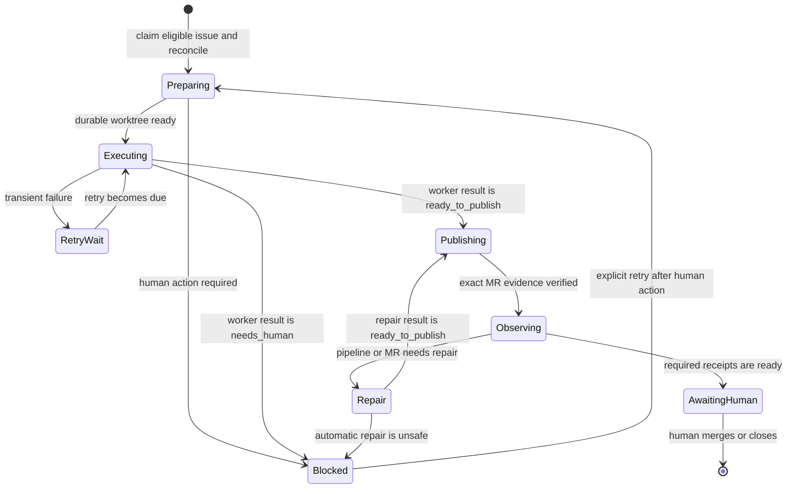

# Recoverable serial agent-loop architecture

This document explains the recoverable architecture used by the serial agent
loop. The [serial GitLab agent-loop explanation](serial-gitlab-agent-loop.md),
reference, and setup guide describe its operator-facing behavior.

The systemd scheduler is healthy. The problem is that the workflow contract
now expects recovery, remediation, and post-publication phases that the runtime
cannot represent. Further point fixes would preserve the mismatch. The
replacement makes every activation a bounded sequence of individually durable
segments in an explicit, recoverable state machine.

## Evidence and confirmed defects

The design audit on 2026-09-09 found a healthy enabled timer whose latest pass
completed successfully with no eligible work. GitLab contained 12 historical
`agent/issue-*` merge requests: 10 merged and two closed. The retained journal
contained 886 idle results and nine failed work results, while issues 13–16
were terminally labelled `agent::failed`. All 68 runner tests passed, showing
that the tests describe the current implementation even where it differs from
the end-to-end workflow contract.

The audit confirmed these defects:

1. Issue selection contradicted the documented contract. The gateway selected
   open, non-confidential issues without a coherent durable queue rule.
2. Existing-MR remediation is documented but not implemented. Remediation
   issues for MR !88 were started on new `agent/issue-*` branches from `main`,
   so the files they needed were absent.
3. Expected blockers collapse into misleading publication failures. A
   dependency on an open MR, an incorrect remediation branch, protected policy
   work, and an intentional no-op all surface as variants of “worker made no
   changes to publish.”
4. Interrupted changes are preserved but cannot be resumed. Checkout cleanup
   creates recovery stashes, but no subsequent runner path restores them. The
   audit found an issue-12 stash containing ten changed files.
5. One ephemeral worker is expected to finish architecture, Red/Green,
   documentation, all reviews, finalization, and post-publication work, even
   though trusted publication occurs only after that worker exits.
6. Python and the Bash wrapper both restore the checkout. The wrapper also
   uses `logger -s` while systemd captures standard output and standard error,
   which duplicates journal lines.
7. Status output omits the phase, stable error code, retry state, and next
   action. The actionable explanation remains in a large private journal while
   GitLab receives only a generic failure comment.
8. Preview refreshes the checkout despite presenting itself as non-mutating;
   failed default-branch pipeline repair is injected into unrelated issue
   work; stale local branches can terminally fail an issue; closed issues keep
   stale terminal labels; and the timer interval is measured from activation,
   not completion.

These observations motivated the recovery architecture. Historical issues,
branches, labels, stashes, and services remain evidence until an operator
reviews a migration preview.

## State model

GitLab remains the shared queue projection. A small local ledger stores the
recoverable execution detail that does not belong in labels.

GitLab labels have deliberately coarse meanings:

| Label | Meaning |
| --- | --- |
| `agent::running` | Work is active or automatically resumable. |
| `agent::awaiting-human` | The exact MR and required receipts are ready for human review. |
| `agent::blocked` | A documented human action is necessary before work can continue. |
| `agent::failed` | An exceptional unrecoverable condition prevented safe reconciliation or recording. |

The ledger refines `agent::running` into `preparing`, `executing`,
`retry-wait`, `publishing`, `observing`, and `repair`. It also records terminal
details for `blocked`, `awaiting-human`, and exceptional `failed` outcomes.
Labels communicate operator-visible ownership; they are not the transaction
log.

## State-machine activation and segments

Every timer activation acquires the single-project lock, reconciles durable
evidence, and advances at most one issue through immediately available
segments. Each segment retains the original recovery boundary:

1. Acquire the single-project local lock.
2. Reconcile GitLab issue and MR data, the durable worktree, Git branches, and
   the local ledger.
3. Resume recoverable `agent::running` work before selecting new work.
4. Select the oldest open, non-confidential issue with no lifecycle projection
   and no ledger record. Unrelated labels do not affect eligibility.
5. Classify it before claiming it as ordinary issue work, existing-MR
   remediation, merge-conflict repair, or protected policy work that requires
   the manual lane.
6. Persist transition intent before the corresponding external mutation, then
   record the observed result. Reconciliation completes or compensates any
   transition interrupted between those writes.
7. Run one bounded worker segment in the issue's durable worktree.
8. Validate a versioned worker result: `ready_to_publish`, `retryable`, or
   `needs_human`.
9. Publish idempotently and verify exact same-project MR, branch, target, tip,
   and closing-issue evidence.
10. Record one safe, actionable outcome. Continue immediately with the same
    issue when progress is safe, or yield when the activation reaches idle,
    no progress or an external wait, `retry-wait`, a terminal or human-facing
    state, or its segment or wall-time bound.

Selection of a fresh issue starts at the beginning of its applicable workflow
and attempts to reach human handoff or another yield condition in that
activation. Reconciliation of an existing record starts at its durable
checkpoint and preserves every remaining applicable phase. Rejection routes
are durable backward transitions and may continue immediately just like
forward transitions.

The default activation runs at most 16 segments or 3,600 seconds, and each
worker has a 1,800-second timeout. The effective timeout passed to each worker
is capped to the activation time remaining. An exhausted effective timeout is
handled by the normal durable retry and recovery path. The timer waits 20
minutes after the complete activation, so that interval controls idle polling
and external waits rather than spacing internal phases. The systemd service
allows 90 minutes for the bounded activation and orderly shutdown. The timer
does not own workflow state or perform checkout cleanup.

## Durable ledger and worktrees

State lives below an XDG state directory, keyed by the configured GitLab host
and numeric project ID. Each active issue owns one durable worktree and one
ledger record. A record contains at least:

- schema version, project identity, issue IID, and work kind;
- state, phase, attempt number, retry deadline, and last transition time;
- base, source, and target branches plus observed commit IDs;
- merge-request identity and last verified publication evidence;
- worker protocol version, latest result kind, and required receipts;
- a stable error code, redacted summary, and explicit next action; and
- transition intent needed to reconcile an interrupted external mutation.

The ledger stores no GitLab token, agent credential, issue-body authority, or
unredacted worker transcript. Writes use atomic replacement and restrictive
permissions. Corrupt or unsupported records become `agent::blocked` when the
runner can still safely record that outcome; they become `agent::failed` only
when safe reconciliation or recording is impossible.

Worktrees, commits, and verified remote refs are normal persistence. Stashes
are emergency evidence only. The runner inventories a recovery stash and
associates it with an issue, but never applies or drops it automatically.

## Invariants

The implementation must maintain these invariants:

- At most one local activation holds the project lock.
- No new issue is claimed while resumable running work exists.
- Project-level loop enablement authorizes unattended work. A new issue is
  eligible only when it is open, non-confidential, has none of
  `agent::running`, `agent::awaiting-human`, `agent::blocked`, or
  `agent::failed`, and has no ledger record.
- One issue maps to one durable worktree and one authoritative source branch.
- Existing-MR remediation uses the verified MR source branch and never creates
  a second MR.
- A transition is replayable: its intent is durable before an external write,
  and reconciliation is safe after interruption at either side of that write.
- Publication is idempotent and accepted only from exact GitLab and Git
  evidence.
- The full repository workflow remains intact, but a worker segment performs
  only the next resumable phase or phase group.
- Expected durable outcomes do not make the systemd unit fail.
- The runner never approves or merges and never widens authority from issue
  text, labels, comments, or worker output.

## Worker protocol and workflow receipts

The one-shot merge-request draft becomes a versioned result envelope. The
envelope identifies the issue, expected ledger transition, completed workflow
phase, receipts produced, result kind, redacted diagnostic, and proposed next
action. The trusted runner validates it against the current record and Git
evidence before changing state.

`ready_to_publish` means the bounded segment produced validated changes or a
validated repair that the trusted runner may publish. `retryable` names a
transient category and retry deadline. `needs_human` names the blocked reason
and a concrete action without treating a deliberate stop as failure.

For ordinary issue work, the coding or content finalizer may return
`ready_to_publish` only with a returned or ledger-retained
`merge_request_draft`. This prevents the trusted runner from reconstructing a
publication request from untrusted issue text. Existing-MR remediation is the
intentional exception: its verified MR supplies the publication target, so no
new draft is required.

Architecture, Red/Green, documentation, review, finalization,
post-publication observation, and repair remain required according to
`AGENTS.md`. Their receipts are persisted between segments. Publication no
longer prevents later post-publication phases because `observing` and `repair`
are durable states.

## Failure taxonomy and process exits

Failures are classified before labels or exit codes are chosen:

| Category | Examples | Durable outcome |
| --- | --- | --- |
| Idle | No resumable record or eligible issue | Successful `idle` |
| Retryable | Timeout, temporary API failure, transient runner contention | `retry-wait`; up to three automatic attempts |
| Human-blocked | Ambiguous request, unmet dependency, protected policy lane, unsafe recovery evidence | `agent::blocked` with exact next action |
| Awaiting review | Exact MR and required receipts verified | `agent::awaiting-human` |
| Unrecoverable | Ledger cannot be safely read or written, irreconcilable identity conflict | `agent::failed` where safely recordable |

Idle, retry scheduled, blocked, and awaiting-human outcomes exit successfully
from systemd. Exit `1` means the runner could not safely record or reconcile
state. CLI-usage errors remain distinct from runtime failure, and lock
contention remains a temporary outcome for interactive callers. The reference
defines the exact CLI, JSON schema, and full exit-code table.

## Recovery and reconciliation

Reconciliation treats ledger intent plus external evidence as the source for a
safe next transition:

- A `running` issue with a valid ledger and worktree resumes its recorded
  phase, regardless of the process that created it.
- A persisted transition intent is checked against GitLab and Git; an already
  completed external mutation is recorded, while an absent idempotent mutation
  may be retried.
- A legacy ordinary `PUBLISHING` or `READY_TO_PUBLISH` record with
  `source_sha`, no `merge_request_draft`, and `intent=null` returns
  side-effect-free to its lane finalizer. Reconciliation never fabricates a
  draft from issue text.
- A missing worktree may be recreated only from recorded and verified commits
  when no uncommitted evidence can be lost.
- A dirty durable worktree remains in place for its next segment. It is not
  cleaned or stashed during normal shutdown.
- An orphan worktree, branch, label, or stash is inventoried and blocked for a
  human decision when ownership cannot be proved.
- Closed issues are reconciled by removing stale queue projections after the
  closure and associated MR evidence are verified.
- Retryable work uses at most three bounded automatic attempts. Exhaustion
  moves it to `agent::blocked`, not `agent::failed`.

## Security and authority boundaries

GitLab issue text and worker results remain untrusted task data. They cannot
select a different project, grant credentials, relax sandboxing, modify
approval policy, or authorize approval or merge. Every API operation stays
under the configured numeric project ID, and every Git/MR identity is verified
against that project.

The ledger and worktrees are local durability, not a distributed lock or a
same-user security boundary. Exactly one host owns unattended processing for a
project. Secrets stay in the existing credential providers and are never
copied into the ledger or journal.

Protected agent-policy changes use a human-directed lane unless a separate
secure cross-agent design is reviewed. The state machine records that boundary
as `agent::blocked`. The publication boundary checks the paths actually changed
in the durable worktree, including template mirrors; it does not weaken the
sandbox or reinterpret the issue as authority.

## Migration and rollout

Migration is evidence-preserving:

1. Stop the timer and confirm no activation holds the project lock.
2. Inventory current running, awaiting-human, failed, blocked, and closed
   projections; exact branch, MR, worktree, and recovery-stash evidence.
3. Run a non-mutating migration preview that proposes ledger records, label
   transitions, retained evidence, and human decisions.
4. Review the preview. Never apply, drop, relabel, close, or delete ambiguous
   evidence automatically.
5. Apply approved migrations idempotently only while the plan and inventory
   remain exact and no ledger record already exists; verify the resulting
   ledger, worktrees, labels, branches, and MRs.
6. Run one eligible, unprojected canary issue through recovery, publication,
   observation, and human handoff.
7. Re-enable the timer only after the canary and operational status output are
   verified.

The implementation is maintained in reviewable slices: ledger and
reconciliation; deterministic selection and classification; durable worktrees
and versioned worker segments; idempotent publication and existing-MR
remediation; post-publication observation and repair; then wrapper, timer,
status, and operational-documentation updates. Each slice follows the full
coding workflow.
