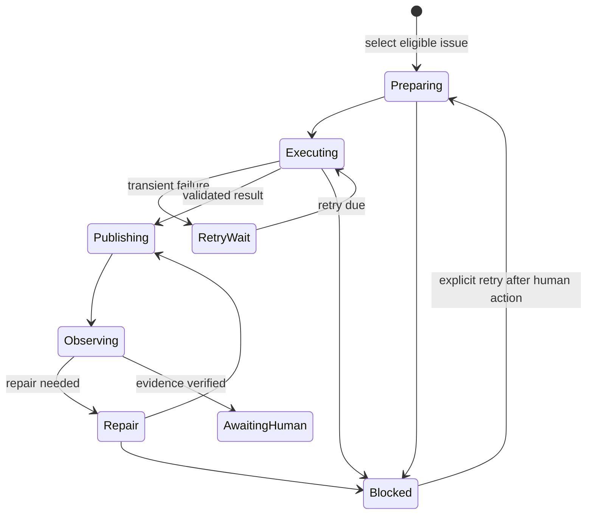

# Why the agent loop is serial and GitLab-native

The agent loop is a recoverable finite-state machine, not a long-running agent
session. Every systemd activation is bounded, but it normally advances one
issue through several individually persisted segments back to back. A later
activation reconciles the last durable boundary and resumes the same issue
before it considers new work.

For a fresh issue, this means attempting the complete applicable workflow in
one activation. For recovered work, it means starting at the saved checkpoint
without skipping any remaining phase. Forward approvals and backward rejection
routes are both ordinary durable transitions, so either can continue
immediately while the activation still has budget and can make progress.

GitLab is the shared, operator-visible projection: active or resumable work is
`agent::running`, an exact verified merge-request handoff is
`agent::awaiting-human`, and a required decision is `agent::blocked`.
`agent::failed` is reserved for an exceptional condition the runner cannot
safely reconcile or record. Labels deliberately do not carry the transaction
history; the local ledger does.

The ledger fills the gap GitLab labels cannot safely represent. It remembers
the selected issue, phase, attempt, retry deadline, durable worktree, branch
and MR evidence, workflow receipts, transition intent, and redacted next
action. Persisting intent before an external mutation makes a partial operation
replayable after a process, host, or API interruption. A durable worktree keeps
ordinary uncommitted evidence in place; a stash is emergency evidence that the
runner inventories but never applies or drops.

Serial execution is a local safety boundary. One host owns unattended work for
a project and a single-project lock prevents overlapping activations. Within
an activation, persisting each transition preserves the same crash-recovery
boundary without imposing a scheduling delay between available phases. The
activation continues only on its current issue; it never consumes a second
issue merely because capacity remains.

The activation yields for terminal or human-facing states, a future retry, a
pending external result, lack of progress, or its segment or wall-time limit.
The 20-minute timer delay begins only after the complete activation finishes,
so it serves idle polling and external waits rather than pacing internal
workflow phases. A 90-minute service timeout leaves room for the default
one-hour activation limit and orderly shutdown. This does not claim distributed
coordination: operators must not run a second timer for the same project.

The activation deadline also bounds individual work. Before invoking a worker,
the runner reduces that worker's configured timeout to the activation time
remaining. If the worker uses that effective timeout, its timeout is recorded
and processed through the existing retry and recovery path rather than losing
the checkpoint.

GitLab remains preferable to a webhook receiver or a filesystem queue because
it already supplies the human work record and MR handoff. The local ledger is
not a second shared queue; it is durability for the host that owns execution.
Enabling the project-level loop authorizes open, non-confidential issues with
no lifecycle projection and no ledger record; unrelated labels are irrelevant.
Resumable running work always has priority. A blocked item resumes only through
an explicit retry after its recorded human action.

The worker is intentionally less trusted than the runner. It reports a
versioned `ready_to_publish`, `retryable`, or `needs_human` envelope; the
trusted runner validates it against the ledger, Git, required workflow
receipts, and the configured numeric GitLab project. Publication and
existing-MR remediation are idempotent. The loop never approves or merges and
does not let issue text, labels, comments, or worker output widen authority.

Issue discussion can still help a worker understand the current work. For that
reason, the runner fetches notes only immediately before an execution, excludes
system and runner-outcome notes, and passes ordinary human and bot discussion
as untrusted context. It does not carry that context across segments or persist
it in the ledger or lifecycle log. A 32 KiB JSON bound keeps the context
bounded; when pruning is necessary, the newest useful notes win while their
chronological order is preserved. Note retrieval and validation use the same
bounded GitLab retry path as other temporary GitLab failures, so a worker never
runs with an unvalidated partial note set.

Retries are for temporary conditions, not for concealing a decision. The
initial attempt plus three retries are bounded; exhaustion becomes blocked with
an actionable next step. The operator-facing commands, JSON contract, exits,
and migration procedure are in the [serial agent-loop reference](../reference/serial-gitlab-agent-loop.md)
and [setup guide](../how-to/setup-serial-gitlab-agent-loop.md).
