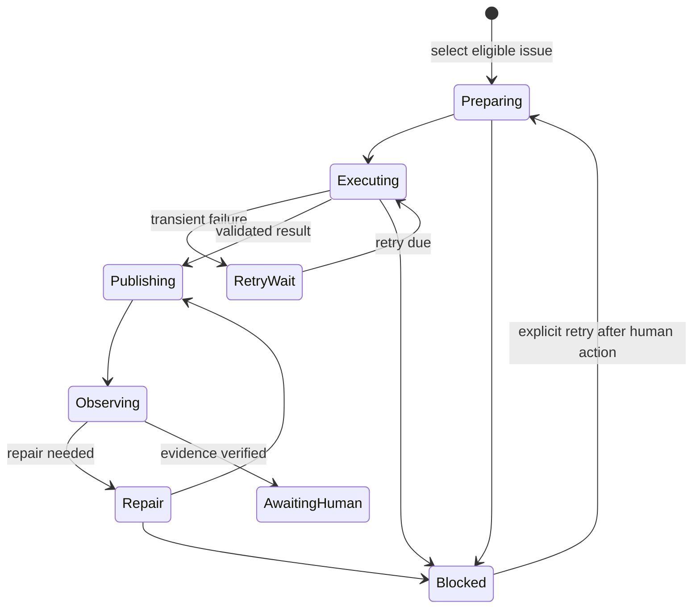

<!-- SPDX-FileCopyrightText: Copyright (c) 2026 NVIDIA CORPORATION & AFFILIATES. All rights reserved. -->
<!-- SPDX-License-Identifier: LicenseRef-NvidiaProprietary -->
<!--  -->
<!-- NVIDIA CORPORATION, its affiliates and licensors retain all intellectual -->
<!-- property and proprietary rights in and to this material, related -->
<!-- documentation and any modifications thereto. Any use, reproduction, -->
<!-- disclosure or distribution of this material and related documentation -->
<!-- without an express license agreement from NVIDIA CORPORATION or -->
<!-- its affiliates is strictly prohibited. -->

# Why the agent loop is serial and GitLab-native

The systemd boundary coordinates, but does not replace, the Python state
machine. It validates each JSON report and starts another one-issue activation
only after a terminal handoff and a fresh eligible preview. Pipeline, retry,
repair, and budget yields return to the timer; they never become a busy loop.

The agent loop is a recoverable finite-state machine, not a long-running agent
session. Every systemd activation is bounded, but its worker owns the complete
applicable workflow session for one issue. A later activation reconciles the
durable worktree and coarse workflow state before it considers new work.

For a fresh issue, this means attempting the complete applicable workflow in
one activation. For recovered work, the runner restores the durable worktree
and re-enters the workflow session at its coarse `WORKFLOW` boundary; it does
not manufacture sidecar checkpoints for Architect, Red, Green, or judges.

Before choosing the coding or content lane, the live Architect decides whether
the issue describes one independently reviewable and mergeable outcome that
can reasonably finish the complete applicable workflow inside the bounded
worker budget. This is a semantic architecture decision based on capability,
dependency order, and workflow breadth, not a line-count or point threshold.
Making it before Red, documentation writing, or any worktree mutation avoids
spending the worker budget on a change that cannot reach a reviewable handoff.

An oversized issue enters a durable decomposition state, not a transient
failure. The worker returns `split_required` with a validated structured plan,
then stops without creating child issues or retrying. The trusted runner owns
the external work: it creates or recovers marker-bound child issues in
dependency order, records its progress after each child, and closes the parent.
This makes recovery safe across a crash while allowing every child to retain its
own merge-request lifecycle.

GitLab is the shared, operator-visible projection: active or resumable work is
`agent::running`, an exact verified merge-request handoff is
`agent::awaiting-human`, and a required decision is `agent::blocked`.
`agent::failed` is reserved for an exceptional condition the runner cannot
safely reconcile or record. Labels deliberately do not carry the transaction
history; the local ledger does.

Fresh selection is deliberately separate from recovery. Once the runner has
handled active/resumable work and eligibility filtering, exact
`agent-priority::high` is first, normal work (including unknown priority-like
labels) is second, and exact `agent-priority::low` is third. Absolute creation
time and IID make each rank deterministic without trusting GitLab API ordering;
invalid timestamp evidence fails closed. Humans use high, low, or label removal
to target, defer, or normalize new work.

The ledger fills the gap GitLab labels cannot safely represent. It remembers
the selected issue, coarse workflow state, attempt, retry deadline, durable
worktree, branch and MR evidence, workflow receipts, transition intent, and
redacted next action. Persisting intent before an external mutation makes a
partial operation replayable after a process, host, or API interruption. A
durable worktree keeps ordinary uncommitted evidence in place; a stash is
emergency evidence that the runner inventories but never applies or drops.

Serial execution is a local safety boundary. One host owns unattended work for
a project and a single-project lock prevents overlapping activations. Within
an activation, the workflow session directly hands Architect context to Red,
Red evidence to Green, and Green's consolidated judge feedback back to the
Architect. The activation continues only on its current issue; it never
consumes a second issue merely because capacity remains.

The activation yields for terminal or human-facing states, a future retry, a
pending external result, lack of progress, or its workflow or wall-time limit.
The 20-minute timer delay begins only after the complete activation finishes,
so it serves idle polling and external waits rather than pacing internal
workflow phases. There is no sequence-wide service timeout: each worker
activation retains its own three-hour overall work budget. This does not claim
distributed coordination: operators must not run a second timer for the same
project.

The activation deadline is the workflow-owning worker's one overall work
budget. Each invocation receives the positive, ceil-rounded time remaining. If
that budget is exhausted, the runner records the timeout and recovers the
durable worktree through the normal retry path rather than losing its changes.

GitLab remains preferable to a webhook receiver or a filesystem queue because
it already supplies the human work record and MR handoff. The local ledger is
not a second shared queue; it is durability for the host that owns execution.
Enabling the project-level loop authorizes open, non-confidential issues with
no lifecycle projection and no ledger record; unrelated labels are irrelevant.
Resumable running work always has priority. A blocked item resumes only through
an explicit retry after its recorded human action.

The worker is intentionally less trusted than the runner. It reports a
versioned `ready_to_publish`, `retryable`, or `needs_human` envelope; the
trusted runner validates it against the ledger, Git, required workflow
receipts, and the configured numeric GitLab project. Publication and
existing-MR remediation are idempotent. The loop never approves or merges and
does not let issue text, labels, comments, or worker output widen authority.

Issue discussion can still help a worker understand the current work. For that
reason, the runner fetches notes only immediately before an execution, excludes
system and runner-outcome notes, and passes ordinary human and bot discussion
as untrusted context. It does not persist that context in the ledger or
lifecycle log. The workflow session itself carries the context needed by its
Architect, Red, Green, and judge handoffs; it does not need a new top-level
worker for each handoff. A 32 KiB JSON bound keeps the context
bounded; when pruning is necessary, the newest useful notes win while their
chronological order is preserved. Note retrieval and validation use the same
bounded GitLab retry path as other temporary GitLab failures, so a worker never
runs with an unvalidated partial note set.

Retries are for temporary conditions, not for concealing a decision. The
initial attempt plus three retries are bounded; exhaustion becomes blocked with
an actionable next step. The operator-facing commands, JSON contract, exits,
and migration procedure are in the [serial agent-loop reference](../reference/serial-gitlab-agent-loop.md)
and [setup guide](../how-to/setup-serial-gitlab-agent-loop.md).
