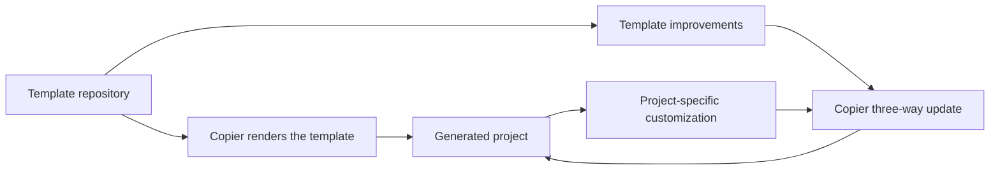

# Why the template and generated project are separate

This page explains the boundary between
this repository and the projects it creates.

This repository is a Copier template, not a starter application that happens
to be copied occasionally. Its `template/` directory is the product: Copier
renders that directory into a new project's files. The root-level tests verify
that rendering and check the output's important structure. In particular, the
template's generated Python package is located at `src/<project_slug>/`, not
at the generated repository root.

That distinction keeps two kinds of change understandable. Template maintainers
can improve shared scaffolding—tooling, CI, workflow guidance, and defaults—in
one place. Generated-project owners can then decide when to adopt those
improvements through Copier's three-way update process.

Generated projects retain one portable `validation (8 gates)` job. It performs
dependency setup once, runs the eight checks with named evidence, and reports
the Python 3.11 and 3.14.3 suites separately. Keeping this behavior in the
template avoids coupling generated projects to this repository's private
registry or credentials. The generated workflow also avoids duplicate push and
merge-request pipelines for the same commit.

The update model intentionally preserves files that are commonly customized,
such as a project's README, dependencies, CI pipeline, package initializer, and
project-specific agent context. A template update should offer an upgrade path,
not silently replace a team's decisions. This makes updates a deliberate
maintenance activity rather than an uncontrolled overwrite.

The agent workflow follows the same ownership rule. `.agents/` is the single
canonical workflow tree; `CLAUDE.md` is only an adapter to `AGENTS.md`, and
`.claude/skills` is a relative compatibility link to `.agents/skills`. Copier
uses a guarded post-render task to replace an identical legacy skills tree;
when the trees differ, it stops without changing either one. The small Claude
settings file is an enforcement adapter for the never-approve-or-merge rule,
not a second workflow definition. During upgrades, a legacy
`.claude/project.md` remains readable until its project-specific context is
reconciled into `.agents/project.md`.

The template combines Python tooling and an agent workflow because it aims to
make a new project productive immediately. UV gives the project a consistent
command entry point, while Ruff, ty, pytest, tox, pre-commit, and GitLab CI
turn the expected development checks into repeatable automation. The workflow
adds explicit design, testing, documentation, review, and merge-request stages
around those tools. Its filesystem-structure gate preserves the `src` Python
layout and, for projects that add Bash, a single `bin/` command backed by
implementation in `src/` or `lib/`.

The gate is intentionally a documented standard rather than a claim that every
project has identical constraints. A project that needs another layout records
its real paths and rationale in `.agents/project.md`, so maintainers and
reviewers can understand the exception without reverse-engineering it from the
tree.

This is a Python-oriented starting point, not a universal template. Its
commands, CI jobs, testing conventions, and agent roles assume Python and its
toolchain. Projects in another language should start with a template designed
for that ecosystem instead of carrying incompatible defaults.

For the exact file and task contract, use the
[template reference](../reference/template-contract.md). For the rationale
behind the generated coding rules, read
[why the coding standards exist](coding-standards.md).
