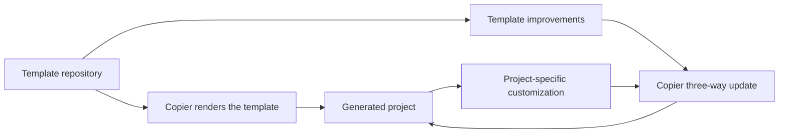

<!-- SPDX-FileCopyrightText: Copyright (c) 2026 NVIDIA CORPORATION & AFFILIATES. All rights reserved. -->
<!-- SPDX-License-Identifier: LicenseRef-NvidiaProprietary -->
<!--  -->
<!-- NVIDIA CORPORATION, its affiliates and licensors retain all intellectual -->
<!-- property and proprietary rights in and to this material, related -->
<!-- documentation and any modifications thereto. Any use, reproduction, -->
<!-- disclosure or distribution of this material and related documentation -->
<!-- without an express license agreement from NVIDIA CORPORATION or -->
<!-- its affiliates is strictly prohibited. -->

# Why the template and generated project are separate

This page explains the boundary between this repository and the projects it creates.

The boundary gives each side a clear job. The template holds shared work. A
generated project holds a team's own work. A team can take new shared work when
it is ready. It can keep its local choices at the same time. This makes an
update easier to review and safer to use.

The split also makes change easy to trace. Shared fixes start in the template.
Local work stays with the project that needs it. Teams can tell which choice is
theirs before they take an update.

This is useful when a project grows. It keeps shared changes easy to find. It
also keeps local work in the hands of the team that owns it.

This repository is a Copier template. It is not a starter application copied
now and then. Its `template/` directory is the product. Copier renders it into
a new project's files. Root tests verify the rendering and its key structure.
The generated Python package lives at `src/<project_slug>/`, not at the
generated repository root.

This split makes two kinds of change clear. Template maintainers improve shared scaffolding, such as tooling, CI, workflow guidance, and defaults, in one place. Generated-project owners choose when to take those improvements through Copier's three-way update process.

The root repository has its own CI boundary. Each merge-request and
default-branch pipeline builds and pushes three project-only validation
candidates. One tooling image contains only four locked CI tools and pinned
system tools. Local development also includes tests, ty,
pre-commit, and tox. Two pytest images contain pinned Git and jq, the project's
locked default dependencies, and the test group for Python 3.11 or 3.14.3.
The Python 3.11 image also contains ty for the full type check and the
dependencies needed by the license check. Other tooling checks use the tooling
image. Each Python's pytest shards and coverage job use its matching image.

Each target has its own commit-and-pipeline tag, registry cache, build
metadata, and digest evidence. This keeps unrelated tools out of the pytest
images and lets GitLab build the lanes independently. The split is meant to
reduce the work on the longest path. It does not promise that a job will meet
a fixed run time. Jobs still validate the current Dockerfile and locked
dependencies, not a stale fixed digest, and do not install dependencies again.
The readability job imports the root package from `src` with `PYTHONPATH` and
runs without a dependency sync.

The root pytest work is a simple DAG, not a state machine. Seventeen Python
3.11 shards and six Python 3.14 shards each make one deterministic, exhaustive
partition of the full suite. Each validates `CI_NODE_INDEX` and
`CI_NODE_TOTAL` before pytest. Each writes a JUnit report and raw coverage
file. A per-Python aggregation job waits for its matching shards. Python 3.11
combines exactly 17 coverage files; Python 3.14 combines exactly six. Both jobs
measure `src/agent_work`, enforce the 85% floor, and publish Cobertura. Invalid
shard metadata, a shard failure, or an aggregation failure fails the pipeline.
Queue time stays outside the unchanged 60-second preference and 120-second
hard per-job limits. The image split does not change each version's full-suite
partition, coverage floor, or reports.

That optimization is only for this repository. Generated projects keep one portable `validation (10 gates)` job, without the private registry image or its credentials. Before `uv run --no-sync` validation, that job always runs `uv sync --locked --all-groups` from its checkout's `pyproject.toml` and `uv.lock` for both Python environments. The root and generated paths differ, but neither can silently validate stale dependencies.

Both CI configurations run only for merge-request events and the default branch. They avoid duplicate feature-branch pipelines.

The update model preserves files that teams often customize. These include a project's README, dependencies, CI pipeline, package initializer, and project-specific agent context. A template update is an upgrade path. It does not silently replace a team's choices. Updates are deliberate maintenance, not uncontrolled overwrites.

The agent workflow has the same ownership boundary. `.agents/` is the one canonical workflow tree. `CLAUDE.md` only adapts to `AGENTS.md`, and `.claude/skills` is a relative compatibility link to `.agents/skills`. A guarded Copier post-render task replaces an identical legacy skills tree. When trees differ, it stops without changing either tree. The small Claude settings file enforces the never-approve-or-merge rule; it is not a second workflow definition. During upgrades, a legacy `.claude/project.md` stays readable until its project-specific context is reconciled into `.agents/project.md`.

The template combines Python tooling and an agent workflow so a new project can be useful at once. UV gives a consistent command entry point. Ruff, ty, pytest, tox, pre-commit, and GitLab CI make expected development checks repeatable. The workflow adds design, testing, documentation, review, and merge-request stages around those tools. Its filesystem-structure gate preserves the `src` Python layout. A project that adds Bash gets one `bin/` command backed by code in `src/` or `lib/`.

This gate is a documented standard, not a claim that all projects share the same limits. A project that needs another layout records its actual paths and rationale in `.agents/project.md`. Maintainers and reviewers can then see the exception without reverse-engineering the tree.

This is a Python-oriented start, not a universal template. Its commands, CI jobs, test conventions, and agent roles assume Python and its toolchain. A project in another language should use a template for that ecosystem, rather than carry incompatible defaults.

For the file and task contract, use the [template reference](../reference/template-contract.md). For the rationale behind generated coding rules, read [why the coding standards exist](coding-standards.md).
